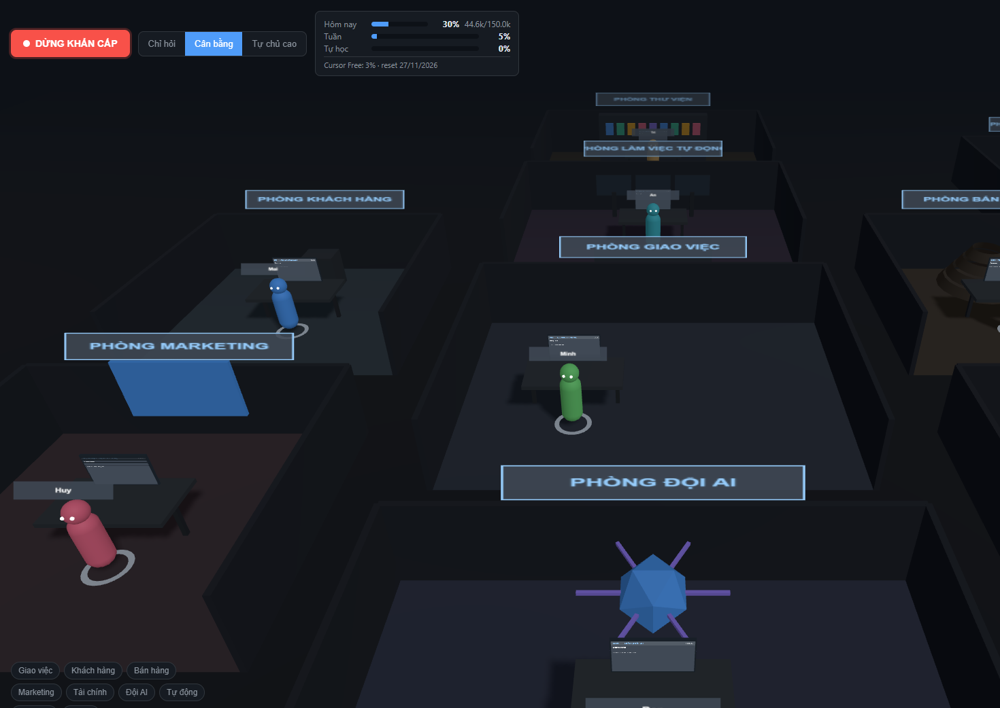

# FunnyOVS — Văn phòng 3D

Văn phòng 3D cho người làm việc một mình: bạn giao việc, các nhân viên AI trong
văn phòng tự làm, tự lên mạng tìm hiểu, tự học và đề xuất cải tiến — nhưng
**không được chạm vào thư mục trên máy bạn nếu chưa được phép**.



---

## Tính năng

| Khu vực | Mô tả |
|---|---|
| **Phòng Giao việc** | Nơi bạn ra lệnh. Hệ thống tách việc và giao đúng nhân vật. |
| **Phòng Khách hàng** | Nhắn tin, phản hồi, chăm sóc khách. |
| **Phòng Bán hàng** | Theo dõi phễu, các bước chuyển đổi. |
| **Phòng Marketing** | Lịch đăng bài, chiến dịch, nội dung. |
| **Phòng Tài chính** | Doanh thu, chi phí, báo cáo. |
| **Phòng Đội AI** | Roster agent, lịch sử chạy, hội thoại. |
| **Phòng Làm việc tự động** | Mỗi agent có máy tính riêng (trình duyệt sandbox) — bấm vào xem họ đang mở trang nào. |
| **Phòng Thư viện** | Ghi chú nghiên cứu, kỹ năng, bài học, bản "nhìn lại" sau mỗi tác vụ. |

Bố cục 3D gồm **9 phòng ban** với 8 nhân vật AI. Thanh điều hướng dưới bên trái
để nhảy nhanh tới từng phòng; click vào sàn phòng để mở bảng điều khiển.

### An toàn (điểm cốt lõi)

- **Sandbox trình duyệt**: mỗi agent dùng profile Chrome riêng, không đụng
  phiên đăng nhập, cookie hay dữ liệu trình duyệt của bạn.
- **Quyền thư mục**: agent mặc định chỉ được chạm `/workspace`. Mọi thao tác
  ngoài đó đều hiện hộp thoại trong cảnh 3D để bạn duyệt:
  *Cho phép một lần · Chỉ đọc · Đọc và ghi · Từ chối*.
- **Chặn cứng**: `~/.ssh`, `~/.gnupg`, thư mục trình duyệt, file `.env`, kho
  mật khẩu, `System32`, `Program Files` — kể cả khi agent xin cũng phải do bạn
  tự bật thủ công.
- **Chống đường dẫn lừa**: chuẩn hóa (`realpath`) trước khi kiểm tra, chặn
  `../` và symlink trỏ ra ngoài.
- **Nhật ký đầy đủ**: mỗi lần truy cập file đều ghi lại thời gian + nhân vật.
- **Tri thức từ web là dữ liệu, không phải mệnh lệnh**: nội dung trang được bọc
  trong khung `UNTRUSTED_WEB_CONTENT`; phát hiện lệnh ẩn (prompt injection) thì
  bỏ qua và báo bạn.
- **Nút Dừng khẩn cấp** to, luôn hiện — dừng toàn bộ agent ngay lập tức.
- **3 mức tự động**: *Chỉ hỏi* · *Cân bằng* (mặc định) · *Tự chủ cao*.
- **Token Budget**: ví riêng cho việc tự học (mặc định 10% hạn mức ngày),
  cảnh báo 80%, khóa 100%, nhật ký chi tiêu theo từng tác vụ.
- **Ước lượng trước khi chạy**: mọi tác vụ được ước lượng chi phí token trước.
  Vượt ngưỡng thì hộp thoại duyệt hiện **ngay trong cảnh 3D** — bạn quyết định
  trước khi agent tiêu token của bạn.
- **Đọc hạn mức Cursor thật**: server poll API nội bộ của Cursor mỗi 60 giây,
  hiển thị % đã dùng và ngày reset trên thanh năng lượng.
- **Đề xuất thay đổi**: agent chỉ tạo diff, bạn duyệt mới áp dụng, có nút Hoàn tác.

---

## Chạy thử

### Yêu cầu
- Node.js 20 trở lên
- Google Chrome hoặc Microsoft Edge (dùng cho trình duyệt sandbox)
- Docker *(tuỳ chọn — chỉ cần nếu bạn muốn cô lập mạnh hơn)*

### Cài đặt

```bash
git clone https://github.com/luanem2709/FunnyOVS.git
cd FunnyOVS
npm install
cp .env.example .env      # Windows: copy .env.example .env
```

Mở `.env` và điền nếu muốn dùng LLM:

```env
OFFICE_LLM_BASE_URL=https://api.openai.com/v1
OFFICE_LLM_API_KEY=sk-...
OFFICE_LLM_MODEL=gpt-4o-mini
```

> Không có API key? Ứng dụng vẫn chạy bình thường ở chế độ quy tắc — mọi
> phòng, nhật ký, phòng thư viện, quyền truy cập đều dùng được.

### Chạy

```bash
npm run dev
```

- Giao diện: <http://localhost:5173>
- API: <http://localhost:8787>

Để chạy bản production:

```bash
npm run build
npm start          # http://localhost:8787
```

### Chạy test

```bash
npm test
```

Bộ test gồm **53 trường hợp**:

1. Agent **không** đọc được file ngoài `/workspace` khi chưa được phép —
   kể cả qua `../` và symlink.
2. Agent **không** làm theo lệnh ẩn trong trang web (prompt injection).
3. Ước lượng token, ngưỡng hỏi trước, trần ngày/tuần/tác vụ, ví học.
4. Nhật ký chi tiêu trong SQLite và bố cục 9 phòng 3D.

---

## Cấu trúc thư mục

```
src/
  server/
    sandbox/pathGuard.ts      chuẩn hóa đường dẫn, chặn cứng, chống traversal
    security/permissions.ts   quản lý cấp quyền, nhật ký truy cập
    security/guardedFs.ts     mọi thao tác file đều đi qua đây
    budget/tokenBudget.ts     Token Budget (đóng băng, cần token để cấu hình)
    budget/cursorAgent.ts     chạy Cursor CLI, đọc token thật từ JSON output
    budget/cursorQuota.ts     đọc hạn mức gói Cursor từ API nội bộ
    budget/cursorAuth.ts      lấy token đăng nhập (runtime, không commit)
    budget/estimation.ts      ước lượng chi phí + tự hạ cấp model
    budget/tokenLedger.ts     nhật ký chi tiêu token (SQLite)
    tasks/taskRunner.ts       điều phối tác vụ, duyệt trước khi tiêu token
    agents/departments.ts     bố cục 9 phòng ban 3D
    activity/activityLog.ts   nhật ký hoạt động
    browser/sandboxBrowser.ts trình duyệt Playwright profile riêng
    browser/policy.ts         allowlist / blocklist / phát hiện hành động rủi ro
    knowledge/knowledgeBase.ts Thư viện Tri thức (SQLite)
    learning/                 nghiên cứu, đối chiếu nguồn, giờ học
    selfdev/proposalStore.ts  đề xuất thay đổi có duyệt + hoàn tác
    automation/               3 mức tự động, giới hạn vòng lặp/thời gian/trang
  client/                     giao diện 3D (three.js)
docs/                         tài liệu thiết kế & phân tích
tests/                        bộ test an toàn
```

---

## Cấu hình chính

| Biến | Mặc định | Ý nghĩa |
|---|---|---|
| `PORT` | `8787` | Cổng server |
| `OFFICE_WORKSPACE` | `./workspace` | Thư mục duy nhất agent được chạm |
| `OFFICE_DATA_DIR` | `./.data` | Nơi lưu SQLite, nhật ký, cấu hình quyền |
| `OFFICE_CHROME_PATH` | tự dò | Đường dẫn Chrome/Edge cho sandbox |
| `OFFICE_LLM_BASE_URL` | rỗng | Endpoint OpenAI-compatible |
| `OFFICE_LLM_API_KEY` | rỗng | API key |
| `CURSOR_AGENT_EXE` | tự dò | Đường dẫn `cursor-agent` (mặc định tìm trong `%LOCALAPPDATA%\cursor-agent`) |
| `CURSOR_AUTH_TOKEN` | tự đọc | Token đăng nhập Cursor (mặc định đọc từ `state.vscdb` của IDE) |
| `CURSOR_QUOTA_ENDPOINT` | `https://api2.cursor.sh` | Endpoint đọc hạn mức Cursor |

### Dùng token từ gói Cursor của bạn

Ứng dụng gọi model qua **Cursor CLI**, nên token tiêu thụ đi vào đúng hạn mức
gói Cursor bạn đang trả tiền — không cần API key riêng.

```powershell
# Cài Cursor CLI (một lần)
irm 'https://cursor.com/install?win32=true' | iex
```

Sau đó đăng nhập (nếu chưa đăng nhập trong Cursor IDE):

```powershell
agent login
```

Ứng dụng sẽ tự tìm token trong `%APPDATA%\Cursor\User\globalStorage\state.vscdb`.
Mục **Cài đặt** hiển thị trạng thái: CLI đã cài, đã đăng nhập, gói hiện tại,
% đã dùng và ngày reset.

> Gói **Free** chỉ cho phép `--model auto`. Gói Pro cho phép chọn model cụ thể
> (`composer-2.5`, `grok-4.7`…) qua mục Cài đặt.

Trong giao diện, mục **Cài đặt** cho phép chỉnh allowlist/blocklist trình duyệt,
hạn mức token (ngày/tuần/tác vụ), phần trăm dành cho tự học và danh sách chủ đề
tự học.

---

## Tài liệu

- [`docs/01-phan-tich.md`](docs/01-phan-tich.md) — phân tích 3 repo nguồn, quyết định thiết kế
- [`docs/02-thiet-ke.md`](docs/02-thiet-ke.md) — sơ đồ kiến trúc & quy tắc an toàn
- [`docs/03-ngan-sach-token.md`](docs/03-ngan-sach-token.md) — ngân sách token & tích hợp Cursor
- [`docs/04-buoc-4-code.md`](docs/04-buoc-4-code.md) — Bước 4: mã nguồn đã viết & số liệu đã đo thật

---

## Giấy phép

MIT. Ba nguồn tham khảo (FounderOS, Agent Zero, My Office) đều MIT — dự án này
chỉ **mượn ý tưởng**, mọi mã nguồn được viết lại.
