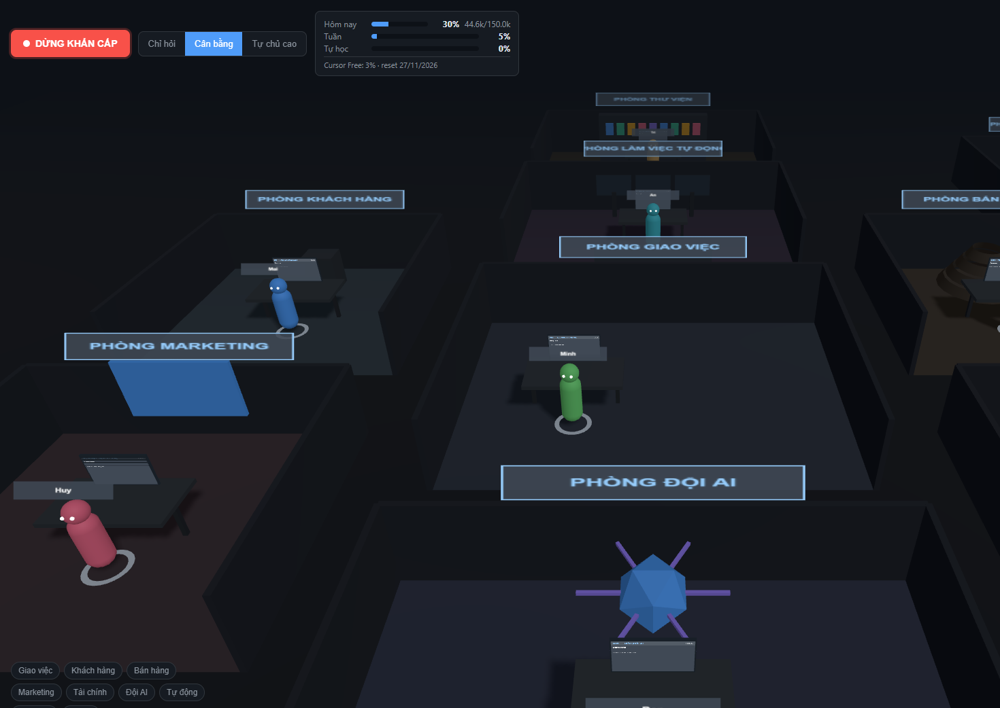
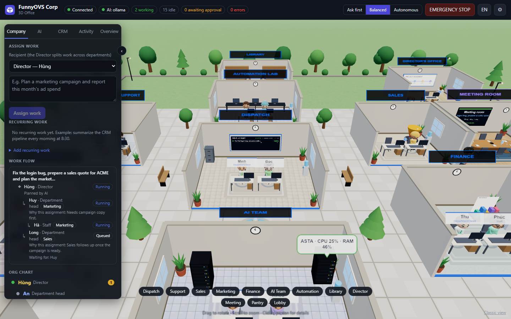
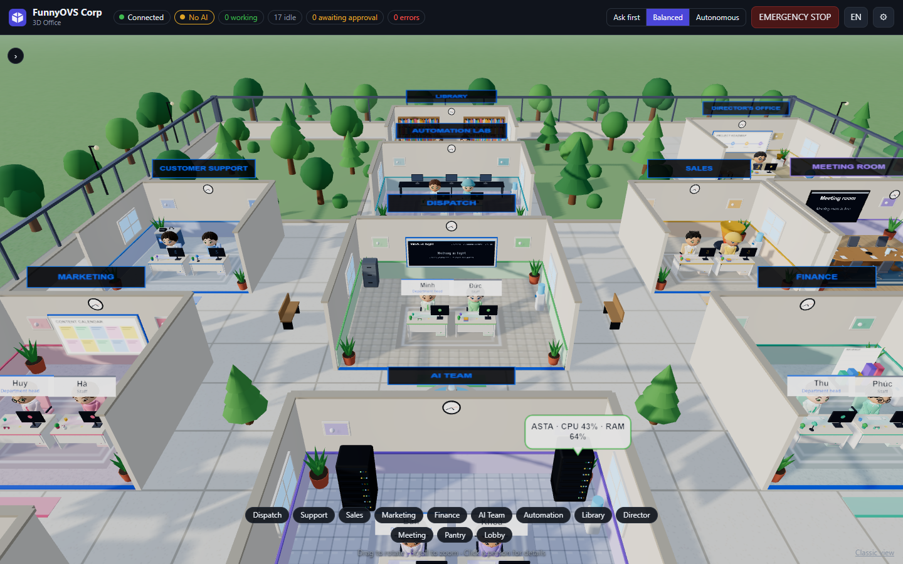

# FunnyOVS — Văn phòng 3D

Văn phòng 3D cho người làm việc một mình: bạn giao việc cho **Giám đốc**, Giám đốc lập kế hoạch
(bằng AI) và chia xuống **Trưởng phòng → Nhân viên**; họ dùng **công cụ thật** (CRM, email, lịch, file,
web, GitHub), tự học và đề xuất cải tiến — nhưng **không được chạm vào thư mục trên máy bạn nếu chưa
được phép**, và **không gửi email/tạo issue nếu bạn chưa duyệt**.



---

## Tính năng

| Khu vực | Mô tả |
|---|---|
| **Phòng Giao việc** | Nơi bạn ra lệnh. Hệ thống tách việc và giao đúng nhân vật. |
| **Phòng Khách hàng** | Nhắn tin, phản hồi, chăm sóc khách. |
| **Phòng Bán hàng** | Theo dõi phễu, các bước chuyển đổi. |
| **Phòng Marketing** | Lịch đăng bài, chiến dịch, nội dung. |
| **Phòng Tài chính** | Doanh thu, chi phí, báo cáo. |
| **Phòng Đội AI** | Roster agent, lịch sử chạy, hội thoại. |
| **Phòng Làm việc tự động** | Mỗi agent có máy tính riêng (trình duyệt sandbox) — bấm vào xem họ đang mở trang nào. |
| **Phòng Thư viện** | Ghi chú nghiên cứu, kỹ năng, bài học, bản "nhìn lại" sau mỗi tác vụ. |

Bố cục 3D gồm **9 phòng ban** với **17 nhân viên** theo 3 tầng (Giám đốc, 8 Trưởng phòng, 8 Nhân viên — mỗi người một ngoại hình riêng, trang phục theo tầng)
và 3 **phòng tiện ích**: **Phòng họp** (Giám đốc họp với các trưởng phòng khi chia việc cho ≥ 2 phòng), **Pantry**, **Sảnh lễ tân** (logo công ty, bảng tin số liệu thật).
Tất cả nằm trong **một toà nhà liền** (tường ngoài kính, cửa chính trước sảnh lễ tân, hành lang, hai sân trong có cây). Mọi phòng cùng một phong cách **chibi** hợp với nhân vật: đồ đạc bo tròn mềm, mỗi phòng một màu riêng (ốp chân tường, viền, khung tranh), mỗi bàn có món đồ riêng của người ngồi (đèn, tai nghe, mèo, sách).
Thanh điều hướng dưới bên trái nhảy nhanh tới từng phòng; click vào sàn phòng để bay tới đó.
Luồng việc đã xong **tải được thành báo cáo Markdown** (tóm tắt của Giám đốc + kết quả từng người).
**Việc đang chạy hiện ngay trong cảnh**: bảng việc sống trên tường Phòng Giao việc (luồng nào đang chạy / chờ duyệt / xong / lỗi, tiến độ, ai đang làm) và huy hiệu số việc mở trên bàn từng người.



*Giám đốc họp với các trưởng phòng; luồng việc chạy xuống từng cấp; bảng việc sống ở Phòng Giao việc.*



*Mọi phòng cùng phong cách chibi: bàn/ghế bo tròn màu theo phòng, món đồ riêng trên bàn từng người; tab AI có nút **+ Thêm API** để gom thêm nguồn.* Thêm ảnh ở [`docs/office-3d.md`](docs/office-3d.md#ảnh-chụp).

### Giao diện hợp nhất (`/office-3d/`)

Tiếng Việt / English (kể cả thông báo do server sinh), 5 tab: **Tổ chức** (giao việc, cây giao việc, nghiệm thu, báo cáo của Giám đốc),
**AI** (kết nối), **CRM** (pipeline, liên hệ, email, lịch), **Nhật ký**, **Tổng quan**. Chi tiết: [`docs/office-3d.md`](docs/office-3d.md).

### Kết nối AI tự động + nút "Thêm API" (gom nhiều nguồn như 9router)

Mở app là nó **tự dò** cổng gom **OmniRoute / 9router** (`:20128`), Ollama (`:11434`), LM Studio (`:1234`) và nhận khoá miễn phí từ biến môi trường
(`GROQ_API_KEY`, `GEMINI_API_KEY`, `CEREBRAS_API_KEY`, `MISTRAL_API_KEY`, `OPENROUTER_API_KEY`, `NVIDIA_API_KEY`, `SAMBANOVA_API_KEY`) hoặc ô dán khoá trong tab **AI**
(mỗi nguồn miễn phí có sẵn đường dẫn tới trang lấy khoá — app không thể tự đăng ký tài khoản thay bạn). Muốn thêm nguồn khác: bấm **+ Thêm API** → chọn mẫu dựng sẵn hoặc tự điền tên,
địa chỉ `…/v1` của **bất kỳ dịch vụ tương thích OpenAI** và khoá → app **kiểm tra thật** (gọi `/models`) rồi mới lưu. Mọi nguồn được gom vào **một bộ định tuyến chung**:
sắp thứ tự ưu tiên bằng mũi tên, chọn **dự phòng theo thứ tự** hoặc **xoay vòng**, nguồn lỗi/hết hạn mức tự bị bỏ qua tạm thời — agent nào cũng dùng chung.
Không cần Cursor. Khoá chỉ lưu trên máy bạn (quyền 0600) và không bao giờ hiện lại.

### Kinh tế tự trị (tuỳ chọn, mặc định TẮT)

Lớp **EAL** cho văn phòng bán báo cáo công khai qua một endpoint trả phí (`HTTP 402` → thanh toán → nội dung), ghi mọi dòng tiền vào **sổ cái băm nối**, mỗi 6 giờ tự tính lãi/lỗ,
tự tạm dừng Scout khi lỗ liên tiếp và **đề xuất** tái đầu tư. Giai đoạn 1 **chỉ nhận tiền** (không giữ khoá ví, không chi ra ngoài); xuất bản, đề xuất của Scout và tái đầu tư đều qua hộp duyệt trong cảnh 3D;
nút dừng khẩn cấp dừng cả lớp này. Bảng KPI treo ở Phòng Tài chính. Bật bằng `ECONOMY_RAIL` (`x402` testnet / `stripe` test / `mock`) — xem [`docs/economy-layer.md`](docs/economy-layer.md) (cấu hình, rủi ro đã biết) và [mô phỏng 30 ngày](docs/economy-backtest.md) (dữ liệu giả, **không** phải dự báo doanh thu).

### Studio dựng clip (hoạt hình khối)

Agent Marketing / Automation Lab lưu **lời đọc, shot list, nhân vật** (dữ liệu nhỏ, kiểm chặt) rồi yêu cầu dựng; kết xuất là bộ máy xác định (three.js + ffmpeg) nên không tốn token lúc dựng và nhân vật được lưu lại để dùng ở mọi clip.
Tiến độ, huỷ và xem clip ở thẻ *Studio dựng clip* (tab Tổng quan). **Lời đọc chỉ được gửi tới dịch vụ giọng online sau khi bạn duyệt** ở hộp duyệt trong cảnh 3D. Giới hạn và cách dùng: [`docs/studio.md`](docs/studio.md).

### Vận hành

**Việc lặp lại** (hằng ngày/tuần, tự giao cho Giám đốc đúng giờ), **sao lưu/khôi phục** dữ liệu ra một tệp JSON (không chứa khoá hay mật khẩu), **nhật ký bảo mật** chỉ-ghi-thêm
(đặt khoá, bật LAN, duyệt/từ chối hành động, gửi email…), chất lượng đồ hoạ **tự hạ khi máy yếu**, tự nối lại khi mất kết nối — xem [`docs/office-3d.md`](docs/office-3d.md).
**Tiếp cận**: dùng được bằng bàn phím, hộp duyệt được đọc to cho trình đọc màn hình, có chế độ giảm chuyển động.

### Truy cập từ máy khác (tuỳ chọn)

Mặc định chỉ máy này truy cập được. Bật **Cài đặt → Truy cập từ máy khác (LAN)** thì máy khác trong mạng nội bộ **bắt buộc nhập mã truy cập** (hiện trong cùng hộp Cài đặt).

### An toàn (điểm cốt lõi)

- **Sandbox trình duyệt**: mỗi agent dùng profile Chrome riêng, không đụng
  phiên đăng nhập, cookie hay dữ liệu trình duyệt của bạn.
- **Quyền thư mục**: agent mặc định chỉ được chạm `/workspace`. Mọi thao tác
  ngoài đó đều hiện hộp thoại trong cảnh 3D để bạn duyệt:
  *Cho phép một lần · Chỉ đọc · Đọc và ghi · Từ chối*.
- **Chặn cứng**: `~/.ssh`, `~/.gnupg`, thư mục trình duyệt, file `.env`, kho
  mật khẩu, `System32`, `Program Files` — kể cả khi agent xin cũng phải do bạn
  tự bật thủ công.
- **Chống đường dẫn lừa**: chuẩn hóa (`realpath`) trước khi kiểm tra, chặn
  `../` và symlink trỏ ra ngoài.
- **Nhật ký đầy đủ**: mỗi lần truy cập file đều ghi lại thời gian + nhân vật.
- **Tri thức từ web là dữ liệu, không phải mệnh lệnh**: nội dung trang được bọc
  trong khung `UNTRUSTED_WEB_CONTENT`; phát hiện lệnh ẩn (prompt injection) thì
  bỏ qua và báo bạn.
- **Nút Dừng khẩn cấp** to, luôn hiện — dừng toàn bộ agent ngay lập tức.
- **3 mức tự động**: *Chỉ hỏi* · *Cân bằng* (mặc định) · *Tự chủ cao*.
- **Token Budget**: ví riêng cho việc tự học (mặc định 10% hạn mức ngày),
  cảnh báo 80%, khóa 100%, nhật ký chi tiêu theo từng tác vụ.
- **Ước lượng trước khi chạy**: mọi tác vụ được ước lượng chi phí token trước.
  Vượt ngưỡng thì hộp thoại duyệt hiện **ngay trong cảnh 3D** — bạn quyết định
  trước khi agent tiêu token của bạn.
- **Hành động ra ngoài cần bạn duyệt**: gửi email, tạo issue GitHub hiện hộp duyệt trong cảnh; hết hạn sau 10 phút nếu không ai trả lời.
- **Đọc hạn mức Cursor (tuỳ chọn, tắt mặc định)**: nếu bạn bật, server poll API nội bộ của Cursor mỗi 60 giây
  và hiển thị % đã dùng. Không dùng Cursor thì bỏ qua hoàn toàn.
- **Đề xuất thay đổi**: agent chỉ tạo diff, bạn duyệt mới áp dụng, có nút Hoàn tác.

---

## Chạy thử

### Yêu cầu
- Node.js 20 trở lên
- Google Chrome hoặc Microsoft Edge (dùng cho trình duyệt sandbox)
- Docker *(tuỳ chọn — chỉ cần nếu bạn muốn cô lập mạnh hơn)*

### Cài đặt

```bash
git clone https://github.com/luanem2709/FunnyOVS.git
cd FunnyOVS
npm install
cp .env.example .env      # Windows: copy .env.example .env
```

Mở `.env` và điền nếu muốn dùng LLM:

```env
OFFICE_LLM_BASE_URL=https://api.openai.com/v1
OFFICE_LLM_API_KEY=sk-...
OFFICE_LLM_MODEL=gpt-4o-mini
```

> Không có API key? Ứng dụng vẫn chạy bình thường ở chế độ quy tắc — mọi
> phòng, nhật ký, phòng thư viện, quyền truy cập đều dùng được.

### Chạy

```bash
npm run dev
```

- Giao diện: <http://localhost:5173>
- API: <http://localhost:8787>

Để chạy bản production:

```bash
npm run build
npm start          # http://localhost:8787
```

### Ứng dụng desktop (Windows)

Bản app bọc server + giao diện 3D vào một cửa sổ Electron; dữ liệu nằm ở
`%APPDATA%\FunnyOVS` (`data/` và `workspace/`). Muốn đặt biến môi trường
(API key LLM...), tạo file `%APPDATA%\FunnyOVS\.env` theo mẫu `.env.example`.

```bash
npm run app:dev          # chạy app ở chế độ phát triển (Vite + Electron)
npm run desktop:dir      # build bản chạy thẳng: release/win-unpacked/FunnyOVS.exe
npm run desktop:dist     # build bộ cài + bản portable trong release/
```

Công ty có 3 tầng — Giám đốc → Trưởng phòng → Nhân viên: giao việc cho Giám đốc, việc được tách theo phòng rồi đẩy xuống từng người (xem `docs/office-3d.md`, trang `/office-3d/`).

Bản app có thêm: thông báo Windows khi agent cần bạn duyệt, biểu tượng ở khay hệ thống
(đóng cửa sổ chỉ thu xuống khay, chọn *Thoát hẳn* để tắt), tuỳ chọn *Khởi động cùng Windows*,
ngày/đêm theo giờ máy (thử bằng `?hour=22` trên URL), bong bóng thoại trên đầu agent,
pháo giấy khi xong việc và agent đi nghỉ giải lao khi rảnh lâu.

### Chạy test

```bash
npm test
```

Bộ test gồm **hơn 350 trường hợp**:

1. Agent **không** đọc được file ngoài `/workspace` khi chưa được phép —
   kể cả qua `../` và symlink; không làm theo lệnh ẩn trong trang web (prompt injection); công cụ web chặn SSRF.
2. Ước lượng token, ngưỡng hỏi trước, trần ngày/tuần/tác vụ, ví học; nhật ký chi tiêu trong SQLite.
3. Điều phối: Giám đốc lập kế hoạch bằng LLM (có dự phòng), thử lại, phụ thuộc giữa các bước, nghiệm thu có cấu trúc.
4. Kết nối AI (dò dịch vụ, router, ngắt mạch), công cụ thật (CRM, email, lịch, GitHub) với máy chủ/`fetch` giả, xác thực token khi mở LAN.
5. Sao lưu/khôi phục, nhật ký bảo mật, việc lặp lại, i18n vi/en (quét tĩnh mọi khoá), cơ sở vật chất/đường đi A*, nhân vật, bảng việc sống, giảm chuyển động.

Kiểm giao diện bằng **Chrome thật** (cần `npx vite build` trước):

```bash
npm run verify:ui                 # AI/CRM/lịch lặp/sao lưu/a11y/bàn phím/duyệt bằng Enter/ngân sách dựng hình/bảng việc sống/máy chủ chết rồi tự nối lại
npm run desktop:dir && npm run verify:desktop         # chạy bản đóng gói FunnyOVS.exe thật
npm run score                      # chấm điểm theo docs/07-diem-so.md
```

Các kịch bản dùng máy chủ cách ly (dữ liệu tạm) và LLM giả, nên không đụng dữ liệu hay khoá AI thật của bạn.

---

## Cấu trúc thư mục

```
src/
  server/
    sandbox/pathGuard.ts      chuẩn hóa đường dẫn, chặn cứng, chống traversal
    security/permissions.ts   quản lý cấp quyền, nhật ký truy cập
    security/guardedFs.ts     mọi thao tác file đều đi qua đây
    budget/tokenBudget.ts     Token Budget (đóng băng, cần token để cấu hình)
    budget/cursorAgent.ts     chạy Cursor CLI, đọc token thật từ JSON output
    budget/cursorQuota.ts     đọc hạn mức gói Cursor từ API nội bộ
    budget/cursorAuth.ts      lấy token đăng nhập (runtime, không commit)
    budget/estimation.ts      ước lượng chi phí + tự hạ cấp model
    budget/tokenLedger.ts     nhật ký chi tiêu token (SQLite)
    tasks/taskRunner.ts       điều phối tác vụ, duyệt trước khi tiêu token
    agents/departments.ts     bố cục 9 phòng ban 3D
    activity/activityLog.ts   nhật ký hoạt động
    browser/sandboxBrowser.ts trình duyệt Playwright profile riêng
    browser/policy.ts         allowlist / blocklist / phát hiện hành động rủi ro
    knowledge/knowledgeBase.ts Thư viện Tri thức (SQLite)
    learning/                 nghiên cứu, đối chiếu nguồn, giờ học
    selfdev/proposalStore.ts  đề xuất thay đổi có duyệt + hoàn tác
    automation/               3 mức tự động, giới hạn vòng lặp/thời gian/trang
  client/                     giao diện 3D (three.js)
docs/                         tài liệu thiết kế & phân tích
tests/                        bộ test an toàn
```

---

## Cấu hình chính

| Biến | Mặc định | Ý nghĩa |
|---|---|---|
| `PORT` | `8787` | Cổng server |
| `OFFICE_WORKSPACE` | `./workspace` | Thư mục duy nhất agent được chạm |
| `OFFICE_DATA_DIR` | `./.data` | Nơi lưu SQLite, nhật ký, cấu hình quyền |
| `OFFICE_CHROME_PATH` | tự dò | Đường dẫn Chrome/Edge cho sandbox |
| `OFFICE_LLM_BASE_URL` | rỗng | Endpoint OpenAI-compatible tuỳ chỉnh (thêm vào chuỗi dự phòng) |
| `OFFICE_LLM_API_KEY` | rỗng | API key cho endpoint đó |
| `OFFICE_OMNIROUTE_URL` / `OLLAMA_HOST` | cổng mặc định | Đổi địa chỉ OmniRoute / Ollama |
| `GROQ_API_KEY`, `GEMINI_API_KEY`, `CEREBRAS_API_KEY`, `MISTRAL_API_KEY`, `OPENROUTER_API_KEY`, `GITHUB_MODELS_TOKEN` | rỗng | Khoá miễn phí được tự nhận |
| `OFFICE_REQUIRE_TOKEN` | tắt | `1` = đòi mã truy cập cả với chính máy này |
| `CURSOR_AGENT_EXE` | tự dò | Đường dẫn `cursor-agent` (mặc định tìm trong `%LOCALAPPDATA%\cursor-agent`) |
| `CURSOR_AUTH_TOKEN` | tự đọc | Token đăng nhập Cursor (mặc định đọc từ `state.vscdb` của IDE) |
| `CURSOR_QUOTA_ENDPOINT` | `https://api2.cursor.sh` | Endpoint đọc hạn mức Cursor |

### Cursor (tuỳ chọn, nâng cao)

Nếu bạn đã trả tiền gói Cursor, có thể cho ứng dụng gọi model qua **Cursor CLI** (`llmBackend: "cursor-agent"` trong cấu hình) để token đi vào đúng hạn mức gói đó.
Mặc định ứng dụng ưu tiên bộ kết nối AI ở trên và chỉ dùng Cursor khi không có nguồn nào khác mà bạn đã đăng nhập.

```powershell
irm 'https://cursor.com/install?win32=true' | iex   # cài Cursor CLI (một lần)
agent login                                          # đăng nhập nếu chưa
```

Đọc **hạn mức** gói Cursor là tính năng riêng, **tắt mặc định** (Cài đặt → Quyền riêng tư): khi bật, ứng dụng đọc token đăng nhập Cursor trên máy này và gọi API nội bộ không chính thức của Cursor.

Trong giao diện, mục **Cài đặt** cho phép chỉnh allowlist/blocklist trình duyệt,
hạn mức token (ngày/tuần/tác vụ), phần trăm dành cho tự học và danh sách chủ đề
tự học.

---

## Tài liệu

- [`docs/01-phan-tich.md`](docs/01-phan-tich.md) — phân tích 3 repo nguồn, quyết định thiết kế
- [`docs/02-thiet-ke.md`](docs/02-thiet-ke.md) — sơ đồ kiến trúc & quy tắc an toàn
- [`docs/03-ngan-sach-token.md`](docs/03-ngan-sach-token.md) — ngân sách token & tích hợp Cursor
- [`docs/04-buoc-4-code.md`](docs/04-buoc-4-code.md) — Bước 4: mã nguồn đã viết & số liệu đã đo thật
- [`docs/office-3d.md`](docs/office-3d.md) — kiến trúc giao diện hợp nhất, kết nối AI, công cụ thật, LAN/token, cơ sở vật chất & nhân vật
- [`docs/06-san-sang-thi-truong.md`](docs/06-san-sang-thi-truong.md) — đánh giá thẳng thắn trước khi bán
- [`docs/07-diem-so.md`](docs/07-diem-so.md) — bảng chấm điểm kiểm chứng được (`npm run score`)

---

## Giấy phép

MIT. Ba nguồn tham khảo (FounderOS, Agent Zero, My Office) đều MIT — dự án này
chỉ **mượn ý tưởng**, mọi mã nguồn được viết lại.
