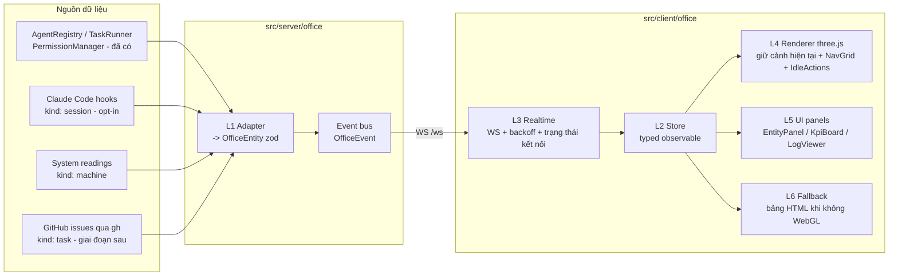

# Bước 5 — Hợp nhất ý tưởng từ 5 dự án "văn phòng 3D"

> Ngày phân tích: 2026-11-21. Repo nguồn được clone **chỉ đọc** vào `references/` (đã nằm trong `.gitignore`).
> Giai đoạn này **chưa viết code**: đây là phân tích, kiến trúc và kế hoạch; cuối tài liệu là các câu cần bạn chốt trước khi code.

---

## 0. Phát hiện quan trọng (đọc trước)

1. **Cả 5 repo đều MIT** → được phép copy code, với điều kiện giữ nguyên thông báo bản quyền. Không có GPL/AGPL.
2. **FunnyOVS không dùng React.** Nó là `three.js` thuần + Vite + Express/WS + SQLite, một trang duy nhất (không có router, không có `src/pages/`).
   Vì vậy phần lớn "mẫu prompt" (React Three Fiber, Zustand, `src/pages/office-3d.tsx`, Next.js) **mâu thuẫn với ràng buộc "không đổi framework"**.
   Kiến trúc dưới đây giữ nguyên các lớp L1–L6 nhưng hiện thực bằng TypeScript + three.js thuần.
3. **Giả định "3/5 repo dùng R3F" không đúng.** Thực tế: R3F chỉ có ở `cubefarm` và `Hermes3D`.
   `my-office`, `agent-office-3d`, `Agentes IA 3D` đều dùng **three.js thuần** — cùng kiểu với FunnyOVS, nên code của 3 repo này port sang gần như trực tiếp.
4. **FunnyOVS đã tái sử dụng code từ `my-office`** (chibi rig, ghi ở đầu `chibiRig.js`) nhưng **chưa có `NOTICE.md`**. Cần bổ sung, bất kể bạn chọn phương án nào.
5. **`Hermes3D` có 17 file `.glb` đồ nội thất** (tên giống bộ Kenney Furniture Kit, CC0) nhưng repo **không ghi nguồn/giấy phép** cho chúng
   → theo ràng buộc "không copy thứ không rõ nguồn gốc", **không copy** cho tới khi xác minh. Có thể tải thẳng từ kenney.nl (CC0) — đó cũng là cách lấp thư mục `public/models` đang trống của FunnyOVS.

---

## 1. Bảng phân tích 5 repo

| Repo | License | Stack | Điểm mạnh | Điểm yếu | Phần tái sử dụng được | Rủi ro |
|---|---|---|---|---|---|---|
| **my-office** (khanh020905) v0.6.0 | MIT | Node ESM server + Next.js shell; **three.js thuần** (`src/office/`, ~500 file JS) | Đọc **session Claude Code thật** qua hooks → SSE; bảng máy (RAM/CPU/dev server treo, dọn an toàn); replay 7 ngày; phát hiện vòng lặp kẹt; chặn ghi đè file; nhiều "cảnh sống" (mưa, mùa, thang máy, karaoke...) | Rất lớn, gắn chặt với Claude Code/macOS; Next.js chỉ là vỏ; nhiều tính năng ngoài phạm vi | `server/platform/*` (đọc RAM/CPU/process), `loops.mjs`, `overlap.mjs`, `redact.mjs`, replay, `people/navigation.js`, `life/weather|seasons` | Ghi vào `~/.claude/settings.json` (hooks) → chỉ làm opt-in; phần macOS không dùng được |
| **agent-office-3d** (jefferysha0627) v0.1.0 | MIT | Node + `server.js` 448 dòng; **three.js thuần**, 4.4k dòng client | **Nhỏ, sạch, dễ đọc**; bảng hành vi nhàn rỗi **dữ liệu hoá** (`IDLE_ACTIONS`: xác suất, thời lượng, địa điểm); nhãn đỏ + "!" khi cần xác nhận; xem terminal agent (chỉ đọc); bảng tin KPI, kệ sách = dự án, con mèo | Giao diện zh-TW; phụ thuộc Herdr/Minecraft (tuỳ chọn); Windows chỉ "thử nghiệm" | `behavior.js` (máy trạng thái nghỉ giải lao), `screens.js`, `bulletin.js`, `cat.js`, `markdown.js` | Minecraft: cần đồng ý EULA Mojang → **bỏ hẳn** |
| **cubefarm** (leonvanzyl) v0.3.20 | MIT | Node + Express/WS + **React Three Fiber** + Vite; 573 file TS, nhiều test | Pipeline hoàn chỉnh **issue → PR → QA phiên mới → auto-merge**; worktree riêng mỗi agent; CEO lập kế hoạch; hạn mức/usage pacing; replay; PWA; có test | Rất nặng; phụ thuộc Claude Agent SDK, `gh`, `@upstash/box` (SaaS tuỳ chọn); R3F ≠ FunnyOVS | `shared/types.ts`, `presence`, `activity`, `issues` (ý tưởng + schema), quy trình QA "phiên mới, không dùng lại phiên tác giả" | `@upstash/box` = dịch vụ trả phí → **loại**; kéo theo SDK lớn |
| **Hermes3D** (iamlukethedev) v1.0.0 | MIT | Next.js 15 + **R3F** + Phaser (2D) + WS proxy; 444 file TS | **Kiến trúc gateway-first** rõ ràng (`ARCHITECTURE.md`); lớp runtime-provider trung lập; mô hình trạng thái agent (focused/idle/blocked/overloaded/waiting/recovering/degraded); office builder (sửa layout); chế độ 2D pixel cho máy yếu; Docker | Phụ thuộc Next/React/Tailwind; nhiều spec chưa hiện thực; 17 GLB không rõ nguồn | Ý tưởng: provider seam, state model, bridge hội thoại, fallback 2D; **không** copy renderer | GLB không rõ nguồn → không copy; Phaser thêm ~1MB nếu làm 2D |
| **Agentes IA 3D** (ederland) | MIT | React + Vite + **three.js thuần** (`office/`) + Firebase + `motor/` chạy Claude Code | **`navgrid.js` A\* 133 dòng** (né tường/đồ, vào phòng qua cửa); pipeline Kanban có **"Espera Aprobación"**; chat nhóm `@mention`; vai trò agent (`roles/catalogo.json`) | **Bắt buộc Firebase** (dịch vụ Google); UI tiếng Tây Ban Nha; `motor/` kéo Whisper/ffmpeg | `NavGrid`, `minifig.js`, mô hình trạng thái tác vụ + duyệt, danh mục vai trò | Firebase → **loại**; chỉ lấy `navgrid` + ý tưởng quy trình duyệt |

### Rủi ro giấy phép tổng hợp
- Mã nguồn: cả 5 MIT → copy được, **phải** giữ dòng `Copyright (c) …` + nội dung giấy phép trong `NOTICE.md` và ở đầu file đã port.
- Tài sản không phải code cần kiểm riêng: GLB của Hermes3D (chưa rõ), font `woff2` của my-office (chưa kiểm), PNG của cubefarm (chưa kiểm). **Không copy asset** trong đợt này.
- Dịch vụ ngoài bị loại: Firebase, Upstash Box, Minecraft/Mojang, (tuỳ chọn) Telegram/ElevenLabs.

---

## 2. So sánh chéo

### Ma trận trùng lặp / bổ trợ

| Năng lực | my-office | agent-office-3d | cubefarm | Hermes3D | Agentes IA 3D | FunnyOVS hiện có |
|---|:-:|:-:|:-:|:-:|:-:|:-:|
| Nhân vật chibi/minifig có animation | ✅ | ✅ | ✅ | ✅ | ✅ | ✅ (đã port từ my-office) |
| Trạng thái agent trực quan | ✅ | ✅ | ✅ | ✅ | ✅ | ✅ (7 trạng thái) |
| Hành vi nhàn rỗi / đi lại | ✅ (rất nhiều) | ✅ (dữ liệu hoá) | ✅ | ◻︎ | ✅ | ◻︎ (mới có nghỉ giải lao cố định) |
| Tìm đường (pathfinding) | ✅ `navigation.js` | ◻︎ | ✅ (rapier) | ◻︎ | ✅ **A\*** | ◻︎ (đường cứng theo cột) |
| Duyệt quyền/tác vụ trong cảnh | ✅ (hook approve) | ✅ (nhãn đỏ) | ✅ | ✅ | ✅ (Kanban) | ✅ **(mạnh nhất: quyền thư mục + token)** |
| Bảng máy (RAM/CPU/process) | ✅ **(duy nhất)** | ◻︎ | ◻︎ | ◻︎ | ◻︎ | ◻︎ |
| Quy trình GitHub issue→PR→QA | ◻︎ | ◻︎ | ✅ **(duy nhất)** | ◻︎ (Jira/GitHub standup) | ◻︎ | ◻︎ |
| Kanban + chat nhóm | ◻︎ | ◻︎ | ✅ | ✅ | ✅ | ◻︎ (có Tác vụ, chưa Kanban) |
| Replay / lịch sử | ✅ | ◻︎ | ✅ | ◻︎ | ◻︎ | ◻︎ (có nhật ký) |
| Runtime provider trung lập | ◻︎ | ◻︎ | ✅ (Claude/Codex/OpenCode) | ✅ **(rõ nhất)** | ◻︎ | ◻︎ (Cursor CLI cố định) |
| Fallback 2D/không WebGL | ◻︎ | ◻︎ | ◻︎ | ✅ (Phaser) | ◻︎ | ◻︎ |
| Sandbox/hạn mức token | ◻︎ | ◻︎ | ✅ (pacing) | ◻︎ | ◻︎ | ✅ **(mạnh nhất)** |

**Trùng lặp:** nhân vật, trạng thái, hành vi nhàn rỗi, Kanban — đều đã có hoặc chỉ cần port nhỏ.
**Bổ trợ thật sự (FunnyOVS chưa có):** tìm đường A\*, bảng hành vi dữ liệu hoá, bảng máy, pipeline GitHub, provider trung lập, fallback không WebGL.
**FunnyOVS mạnh hơn cả 5:** an toàn (sandbox, quyền thư mục, chống prompt injection) và ngân sách token — **không đổi phần này**.

### Phân vai đã điều chỉnh (so với đề xuất ban đầu của bạn)

| Repo | Vai đề xuất ban đầu | Vai thực tế nên giao | Lý do |
|---|---|---|---|
| Hermes3D | Khung kiến trúc + giao diện chính | **Chỉ lấy kiến trúc** (provider seam + state model + fallback 2D) | Giao diện của nó là Next/R3F; khung giao diện chính vẫn là FunnyOVS |
| agent-office-3d | Trạng thái agent + xem terminal | **Hành vi nhàn rỗi dữ liệu hoá** + nhãn xác nhận + xem terminal chỉ đọc | Nhỏ, three.js thuần, port gần như nguyên |
| my-office | Tài nguyên (RAM/session), hook hệ thống | **Bảng máy** (kind `machine`) + **phiên Claude Code thật** (kind `session`, opt-in) | Đúng sở trường; nhưng bỏ phần macOS-only |
| cubefarm | Luồng GitHub issue + orchestration | **Chỉ ý tưởng + schema** (issue→PR→QA); không kéo SDK/Upstash | Quá nặng nếu copy; làm sau |
| Agentes IA 3D | Phê duyệt task + chat | **`navgrid.js` A\*** + trạng thái "chờ phê duyệt"; chat nhóm làm sau | Phê duyệt FunnyOVS đã mạnh hơn; thứ thiếu là tìm đường |

---

## 3. Kiến trúc hợp nhất (L1–L6, hiện thực bằng three.js thuần)



| Lớp | Vị trí đề xuất | Lấy cảm hứng / tái sử dụng từ |
|---|---|---|
| L1 Adapter | `src/server/office/entityAdapter.ts` | **Hermes3D** (provider seam, "backend là nguồn sự thật"); `my-office/server/platform` cho `machine` |
| L2 Store | `src/client/office/store.ts` (~80 dòng, không cần Zustand) | Mô hình của cubefarm `client/src/store.ts` (ý tưởng) |
| L3 Realtime | `src/client/office/socket.ts` | Thay `ws.onclose → setTimeout(2000)` cố định hiện tại bằng backoff + trạng thái `connecting/open/closed` |
| L4 Renderer | giữ `src/client/main.ts` + module mới `navgrid.ts`, `idleActions.ts` | **Agentes** `navgrid.js`; **agent-office-3d** `behavior.js` |
| L5 UI | `src/client/office/ui/*.ts` (DOM thuần, cùng kiểu `openPanel` hiện tại) | agent-office-3d (`screens.js`, `bulletin.js`), Hermes3D (`agent-state-model-spec`) |
| L6 Fallback | `src/client/office/fallback.ts` | Hermes3D (chế độ 2D) — bản tối giản: bảng, không Phaser |

### Schema chung

```ts
// src/shared/officeEntity.ts  (zod đã có trong dependencies)
import { z } from "zod";

export const EntityKind = z.enum(["agent", "session", "machine", "task"]);
export const EntityStatus = z.enum([
  "idle", "working", "researching", "learning", // giữ nguyên từ FunnyOVS
  "pending-approval", "blocked", "error", "offline", "stopped",
]);

export const OfficeEntity = z.object({
  id: z.string(),
  name: z.string(),
  kind: EntityKind,
  status: EntityStatus,
  department: z.string().optional(),            // id phòng ban (departments.ts)
  position: z.object({ x: z.number(), y: z.number().default(0), z: z.number() }).optional(),
  metadata: z.record(z.unknown()).default({}),   // cpu, ram, taskTitle, url, tokensUsed...
  updatedAt: z.string(),                         // ISO 8601
});
export type OfficeEntity = z.infer<typeof OfficeEntity>;
```

> Lưu ý: schema mẫu trong prompt chỉ có 5 trạng thái. FunnyOVS đang dùng 7 (`researching`, `learning`, `blocked`, `stopped`), nên schema gộp phải là **tập hợp cha** để không mất thông tin. Mapping sang 5 trạng thái đơn giản dùng cho KPI/fallback.

### Event bus (discriminated union)

```ts
export type OfficeEvent =
  | { type: "snapshot";        entities: OfficeEntity[]; at: string }
  | { type: "entity.created";  entity: OfficeEntity }
  | { type: "entity.updated";  entity: OfficeEntity }
  | { type: "entity.removed";  id: string }
  | { type: "status.changed";  id: string; from: EntityStatus; to: EntityStatus; at: string }
  | { type: "log";             entityId?: string; level: "info" | "warn" | "error"; text: string; at: string }
  | { type: "approval.requested"; id: string; entityId: string; kind: "permission" | "token"; summary: string }
  | { type: "approval.decided";   id: string; decision: "approve" | "deny" };
```

Ánh xạ từ sự kiện WS hiện có (để **không phá** client cũ): `agent:update → entity.updated + status.changed`, `permission:request / task:approval → approval.requested`, `browser:log → log`, `state → snapshot`.
Giai đoạn đầu server **phát song song** cả sự kiện cũ lẫn `office:*` mới; chỉ bỏ sự kiện cũ khi mọi nơi đã chuyển.

---

## 4. So sánh 3 phương án

| Phương án | Ưu | Nhược | Công sức | Rủi ro license | Liền mạch UX | Bảo trì |
|---|---|---|:-:|---|---|---|
| **A. Monorepo hợp nhất** (gộp component cả 5 repo vào 1 package) | Mọi thứ trong một nơi | Kéo React/Next/R3F/Firebase/SDK vào dự án three.js thuần → **vi phạm "không đổi framework"**, xung đột phiên bản `three`, bundle phình | **L** | Trung bình (nhiều thông báo cần giữ; asset chưa rõ) | Trung bình (nhiều phong cách UI khác nhau) | **Kém** |
| **B. Micro-frontend** (mỗi repo là một widget, iframe/Module Federation) | Không sửa code nguồn | 5 server + 5 cổng, mỗi repo đòi môi trường riêng (Claude Code, Firebase, gh...), không chia sẻ trạng thái, **ngược hoàn toàn mục tiêu "hợp nhất"**, sandbox/quyền của FunnyOVS không bao được | **L** | Thấp | **Kém** (cảm giác 5 app dán lại) | Kém |
| **C. Viết lại tối giản, port có chọn lọc** (giữ FunnyOVS làm lõi; port đúng các module nhỏ + lấy ý tưởng) | Giữ stack, giữ sandbox/token budget; port 3 repo three.js thuần gần như nguyên; rollback dễ (feature flag) | Phải tự viết adapter/store; cubefarm và my-office chỉ lấy một phần | **M** | Thấp (chỉ vài file, đều MIT, ghi `NOTICE.md`) | **Tốt** (một giao diện thống nhất) | **Tốt** |

### Chọn: **Phương án C**, chia thành 4 giai đoạn có thể dừng bất kỳ lúc nào

| GĐ | Nội dung | Công sức | Port từ |
|---|---|:-:|---|
| 1 | L1–L3: `OfficeEntity` + adapter + store + socket có backoff + banner mất kết nối; `NOTICE.md` | S | Hermes3D (ý tưởng) |
| 2 | L4: `NavGrid` A\* thay đường cứng; `IdleActions` dữ liệu hoá (cà phê, máy chạy bộ, mèo...) | S–M | Agentes `navgrid.js`, agent-office-3d `behavior.js` |
| 3 | L5/L6: `EntityPanel`, `KpiBoard`, `LogViewer`, fallback bảng khi không WebGL | M | agent-office-3d, Hermes3D |
| 4 | Nguồn mới: `machine` (RAM/CPU), `session` Claude Code (opt-in), `task` từ GitHub issue (`gh`) | M–L | my-office `platform/*`, cubefarm (ý tưởng) |

Mỗi giai đoạn tự đứng được; dừng ở GĐ 2 đã có cải thiện thấy rõ (agent đi lại tự nhiên, không xuyên đồ).

---

## 5. Kế hoạch triển khai (file cụ thể)

Thứ tự: phụ thuộc → cấu hình build → adapter → store → realtime → renderer → UI → fallback → docs.

| # | File | Việc |
|---|---|---|
| 1 | `NOTICE.md` (mới) | Attribution 5 repo + my-office (đã port chibi rig) |
| 2 | `src/shared/officeEntity.ts` (mới) | Schema zod + `OfficeEvent` + type guard |
| 3 | `tsconfig.json`, `vite.config.ts` | Cho client import `src/shared/*` (alias), không thêm framework |
| 4 | `src/server/office/entityAdapter.ts` (mới) | `AgentState/TaskRecord/PermissionRequest → OfficeEntity` |
| 5 | `src/server/main.ts` | Phát `office:*` song song sự kiện cũ; thêm `GET /api/office/entities` |
| 6 | `src/client/office/store.ts`, `socket.ts` (mới) | Store + WS backoff + trạng thái kết nối |
| 7 | `src/client/main.ts` | Đọc từ store; bỏ `connectWs` cố định 2s; cờ `?office=legacy` để rollback |
| 8 | `src/client/assets/navgrid.ts`, `idleActions.ts` (mới) | Port A\* + bảng hành vi; thay logic trong `behavior.ts` |
| 9 | `src/client/office/ui/entityPanel.ts`, `kpiBoard.ts`, `logViewer.ts` (mới) | Panel DOM, cùng khung `openPanel` |
| 10 | `src/client/office/fallback.ts` (mới) | Bảng HTML khi `!webgl` hoặc WebGL context lost |
| 11 | `tests/office.test.ts` (mới) | Adapter, store, NavGrid (không xuyên tường), backoff |
| 12 | `docs/office-3d.md` (mới) | Kiến trúc, cách thêm `kind`/renderer mới, rollback |

**Rollback:** cờ `office.v2` trong `config.json` (mặc định tắt cho tới khi ổn) + `?office=legacy` trên URL; mọi thay đổi ở server là *thêm*, không xoá sự kiện cũ.

---

## 6. Việc cần làm bất kể phương án

- Thêm `NOTICE.md` (my-office đã được port nhưng chưa có thông báo ở gốc dự án).
- Không copy asset (GLB/font/PNG) từ 5 repo; lấy Kenney (CC0) trực tiếp từ kenney.nl nếu cần model.
- Không thêm dependency nặng: không React, không Zustand, không Firebase, không Upstash, không Phaser (trừ khi bạn chọn có chế độ 2D thật).

---

## 7. Quyết định đã chốt và tình trạng triển khai

| Câu hỏi | Quyết định của bạn | Hệ quả |
|---|---|---|
| Stack | **Chuyển sang React + R3F + Zustand** | Thêm `react`, `react-dom`, `@react-three/fiber`, `zustand`, `@vitejs/plugin-react`. Làm **song song** với giao diện cổ điển (trang `/office-3d/`) thay vì viết lại cái cũ → rollback không mất gì. R3F bọc các module three.js hiện có. |
| Phương án / phạm vi | **C, cả 4 giai đoạn** | Đã làm GĐ 1–3 và phần *bảng máy* của GĐ 4 |
| Nguồn dữ liệu GĐ 4 | **Chỉ bảng máy** | Không cài hooks Claude Code, không đọc GitHub issue |
| Model 3D Kenney | **Có, tải Furniture Kit** | **Chưa làm được:** kenney.nl chặn tải bằng script (HTTP 403) và pane trình duyệt không cho tải file. Cần bạn tải tay (xem `NOTICE.md`) |

Đã hiện thực: `src/shared/officeEntity.ts`, `src/server/office/*`, `src/client/office-3d/*`, `navgrid.ts`, bảng hành vi nhàn rỗi, `NOTICE.md`, `docs/office-3d.md`, 92 test.
Chưa làm: phiên Claude Code thật, GitHub issue (không được chọn), model Kenney (bị chặn tải), vẽ thực thể `task` trong cảnh.
