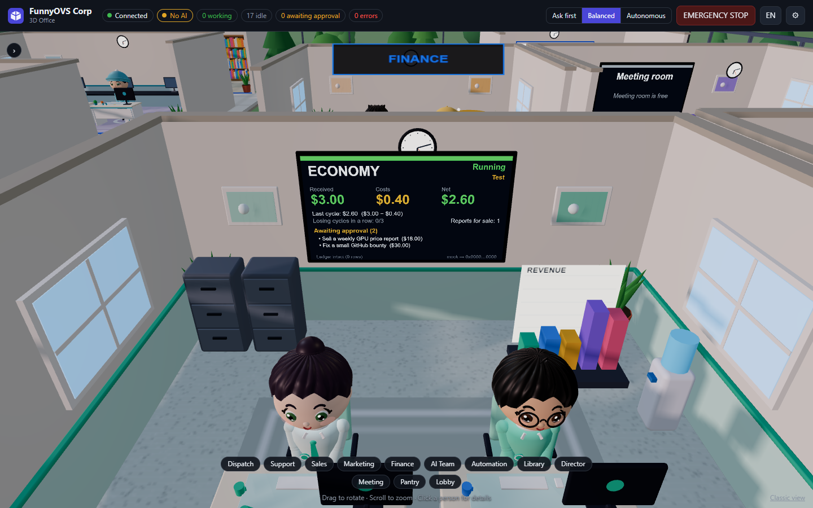
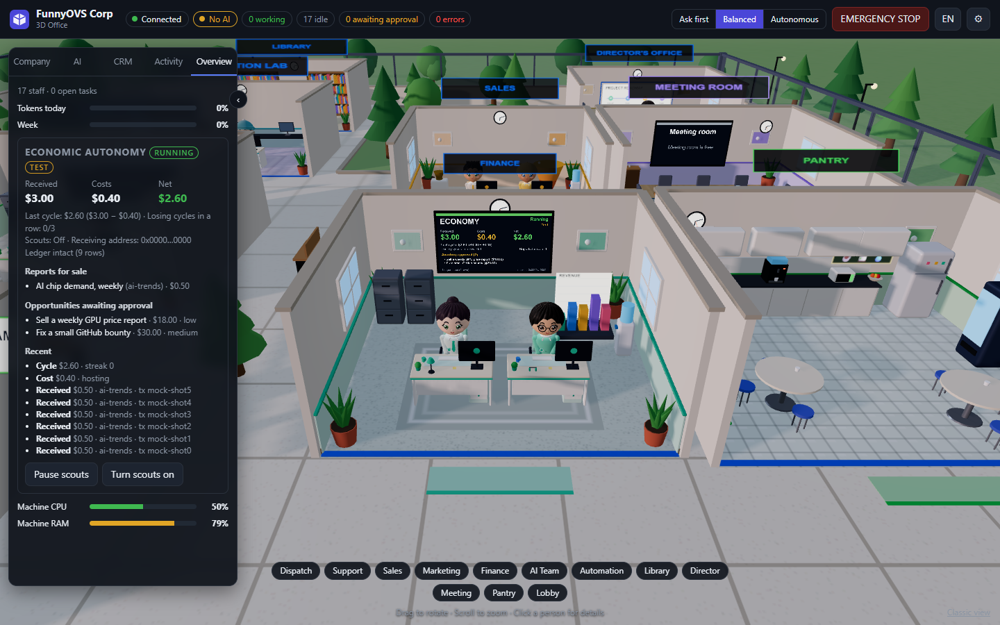

# Economic Autonomy Layer (EAL)

Lớp kinh tế cho phép văn phòng **tìm cơ hội kiếm tiền, bán sản phẩm số, ghi sổ và tự đánh giá lỗ/lãi** — nhưng ở giai đoạn 1 nó **chỉ NHẬN tiền**:
không giữ khoá ví, không chi tiền ra ngoài, không tự đăng ký dịch vụ. Mọi thứ "ra ngoài" hoặc "tốn tiền" là **đề xuất chờ bạn duyệt** trong cảnh 3D.

> **Mặc định TẮT.** Không đặt `ECONOMY_RAIL` thì không có gì thay đổi: không cổng mới, không công cụ mới hoạt động, bảng KPI hiện "TẮT".
> Mô phỏng 30 ngày: [`economy-backtest.md`](economy-backtest.md) (dữ liệu giả — **không** phải dự báo doanh thu).

## 1. Nguyên tắc (kế thừa từ FunnyOVS, không bị thay đổi)

| Ràng buộc | EAL thực hiện thế nào |
|---|---|
| Human-in-the-loop cho mọi hành động ra ngoài | Xuất bản sản phẩm, đề xuất cơ hội của Scout, đề xuất tái đầu tư đều đi qua **`ActionGate` có sẵn** (hộp duyệt trong cảnh 3D, hết hạn sau 10 phút = từ chối). Không có đường nào bỏ qua hộp duyệt. |
| Không giữ tiền / không chi tiền | Giai đoạn 1 không có "gửi tiền". x402 chỉ cần **địa chỉ nhận công khai** (cấu hình khoá riêng làm địa chỉ bị từ chối); Stripe chỉ **đọc** trạng thái phiên bằng khoá test. "Tái đầu tư" chỉ ghi quyết định — bạn tự thực hiện. |
| Sandbox / quyền thư mục | Scout dùng công cụ như mọi nhân viên (`TOOL_POLICY`, `GuardedFs`). Sản phẩm chỉ đọc từ `<workspace>/public/insights/` (không bao giờ CRM, email, KB riêng, tệp ngoài workspace). |
| Nhật ký chỉ-ghi-thêm | Mọi quyết định/giao dịch ghi vào nhật ký bảo mật (`economy.*`, không chứa bí mật) **và** vào **sổ cái băm nối** riêng (xem §3). |
| Ngân sách token | Scout chạy qua lịch việc lặp lại + `TaskRunner` nên vẫn ước lượng token, xin duyệt khi vượt ngưỡng, trừ ngân sách. Chi phí token còn được tính vào chu kỳ kinh tế (quy ước). |
| Nút dừng khẩn cấp | Bật → cổng công khai trả **503 và không thu tiền**, không chạy chu kỳ, từ chối xuất bản/đề xuất mới, `gate.denyAll()` từ chối mọi hộp duyệt đang chờ, Scout dừng (lịch bị tạm dừng bởi `Scheduler`). |

## 2. Kiến trúc

```
 Scout (nhân viên Tài chính / Automation / Thư viện)         Người vận hành (bạn)
   công cụ `economy_propose`  ──►  EconomyService.propose ──►  HỘP DUYỆT (ActionGate) ──► ghi nhận quyết định
                                                                  ▲
 báo cáo Markdown ──► public/insights/<chủ-đề>.md                 │
   POST /api/economy/publish ──► quét riêng tư ──► HỘP DUYỆT ──► gian hàng (lưu băm nội dung)
                                                                  
 Người mua ──► [CỔNG CÔNG KHAI RIÊNG :ECONOMY_PUBLIC_PORT]  GET /api/public/insights/:topic
                 chưa trả tiền ──► 402 + yêu cầu thanh toán (x402 / Stripe / mock)
                 có bằng chứng ──► verify ─► kiểm băm nội dung ─► settle ─► ghi sổ cái ─► 200 + nội dung

 Bộ hẹn giờ (mỗi ECONOMY_LOOP_HOURS) ─► runCycle: doanh thu − (token quy ước + hạ tầng + chi phí ghi tay)
      lỗ N chu kỳ liên tiếp ─► tạm dừng Scout + báo người vận hành
      lãi                   ─► đề xuất tái đầu tư (qua hộp duyệt, có ngưỡng và thời gian chờ)
 Mọi thay đổi ─► OfficeEvent `economy.state` / `economy.event` ─► bảng KPI Phòng Tài chính + thẻ "Kinh tế tự trị" ở tab Tổng quan
```

**Dùng lại cấu trúc agent sẵn có** thay vì dựng hệ song song: Scout là nhân viên của các phòng đã có (Tài chính, Automation, Thư viện — phòng nào có `economy_propose` trong `TOOL_POLICY`); việc "quét cơ hội" là một **lịch việc lặp lại** giao cho Giám đốc (`Scheduler`), Giám đốc tự tách việc xuống phòng và nghiệm thu như mọi việc khác.
*Khác với bản đề xuất ban đầu:* không thêm phòng ban thứ 10 (đổi bố cục/đường đi/nhân vật rất rộng) và **Phòng Tài chính vẫn không có `web_fetch`** (test đặc quyền tối thiểu giữ nguyên) — việc đọc web do Automation/Thư viện làm, Tài chính chỉ đánh giá.

### File

| File | Việc |
|---|---|
| `src/shared/economy.ts` | Kiểu dùng chung (tiền = số nguyên micro-USD), trạng thái, sự kiện, cơ hội. |
| `src/server/economy/ledger.ts` | Sổ cái băm nối, không xoay vòng, không bí mật; `verify()`. |
| `src/server/economy/payment.ts` | Rail **x402** (USDC/Base), **Stripe Checkout (test)**, **mock**; chỉ nhận tiền. |
| `src/server/economy/products.ts` | Đọc `public/insights`, quét riêng tư, kho sản phẩm (băm nội dung lúc duyệt). |
| `src/server/economy/service.ts` | Xuất bản, paywall, đề xuất, chu kỳ, tạm dừng/tiếp tục, tái đầu tư. |
| `src/server/economy/publicServer.ts` | Cổng công khai **riêng**: chỉ 3 đường dẫn, giới hạn tốc độ. |
| `src/server/routes/economy.ts` | REST trên API chính (thay đổi chỉ từ chính máy). |
| `src/server/agent/tools.ts` | Công cụ `economy_propose` (chỉ đề xuất). |
| `src/shared/officeEntity.ts` | Sự kiện `economy.state`, `economy.event`. |
| `src/client/assets/economyBoard.ts`, `ui/EconomyCard.tsx` | Bảng KPI 3D ở Phòng Tài chính, thẻ ở tab Tổng quan. |
| `scripts/economy-backtest.ts` | Mô phỏng 30 ngày. |

## 3. Sổ cái và nhật ký

* **Sổ cái** `<dữ liệu>/economy.ledger.jsonl`: mỗi dòng có `seq`, giờ, loại (`settled`, `cost`, `cycle`, `paused`, `published`, `opportunity`, `reinvest`, `failed`…), số tiền (micro-USD), mã tham chiếu và `hash = SHA-256(dòng trước + nội dung)`.
  Sửa số tiền, xoá, chèn hoặc đổi thứ tự một dòng cũ → `verify()` báo hỏng (hiện trên thẻ/bảng KPI: "SỔ CÁI BỊ SỬA"). **Không xoay vòng** (khác `audit.log` xoay ở 1 MB).
* **Giới hạn nói thẳng:** băm nối chống sửa vô ý/sửa tay, **không** chống kẻ có toàn quyền ghi đĩa viết lại cả chuỗi. Muốn chống cả điều đó, định kỳ ghi băm dòng cuối ra nơi khác (email cho chính bạn, ghi chú ngoài máy). Chưa làm tự động.
* **Nhật ký bảo mật** có thêm: `economy.publish|unpublish|sale|opportunity|cost|cycle|paused|resumed|scouts|reinvest` (chỉ số/chuỗi ngắn, đã che bí mật).
* Quote (báo giá) chỉ là sự kiện hiển thị (giới hạn 1 lần/2 giây/chủ đề), **không** ghi sổ cái để yêu cầu rác không làm đầy đĩa; giao dịch lỗi ghi tối đa 1 dòng/5 giây.

## 4. Cấu hình

Mọi thứ qua biến môi trường (đặt trước khi khởi động; bản desktop đọc từ môi trường của tiến trình).

| Biến | Mặc định | Ý nghĩa |
|---|---|---|
| `ECONOMY_RAIL` | *(tắt)* | `x402`, `stripe` hoặc `mock` (mock chỉ để thử). |
| `ECONOMY_X402_PAY_TO` | — | Địa chỉ nhận **công khai** `0x…` (40 hex). Khoá riêng bị từ chối. |
| `ECONOMY_X402_NETWORK` | `base-sepolia` | `base-sepolia` (testnet) hoặc `base` (cần `ECONOMY_ALLOW_LIVE=1`). |
| `ECONOMY_X402_FACILITATOR` | `https://x402.org/facilitator` | Bên trung gian kiểm/thanh toán (phải https). Kiểm tra điều khoản và trạng thái hiện tại của nó — chưa được xác minh ở đây. |
| `ECONOMY_STRIPE_KEY` | — | Khoá **test** `sk_test_…`. Khoá `sk_live_…` bị từ chối nếu không có `ECONOMY_ALLOW_LIVE=1`. |
| `ECONOMY_ALLOW_LIVE` | — | `1` = cho phép mạng chính/khoá live. **Giai đoạn 1 nên để trống.** |
| `ECONOMY_PUBLIC_PORT` | *(không mở)* | Mở cổng công khai riêng cho sản phẩm trả phí. |
| `ECONOMY_PUBLIC_HOST` | `127.0.0.1` | Địa chỉ nghe của cổng công khai. |
| `ECONOMY_PUBLIC_BASE_URL` | lấy từ Host | Địa chỉ gốc công khai (ghi vào yêu cầu thanh toán / URL thành công của Stripe). |
| `ECONOMY_TRUST_PROXY` | — | `1` khi đứng sau proxy của bạn (để giới hạn tốc độ theo IP thật). |
| `ECONOMY_MAX_PRICE_USD` | `5` | **Trần giá** mỗi sản phẩm (đây là "ngưỡng tiền tệ" của giai đoạn 1; không có chi tiền ra nên mọi xuất bản/đề xuất đều phải duyệt bất kể số tiền). |
| `ECONOMY_LOOP_HOURS` | `6` | Chu kỳ đánh giá. |
| `ECONOMY_NEGATIVE_CYCLES` | `3` | Lỗ bấy nhiêu chu kỳ liên tiếp thì tạm dừng Scout. **Nên ≥ 12 khi chạy thật** (xem mô phỏng). |
| `ECONOMY_TOKEN_PRICE_USD_PER_MTOK` | `0.5` | Đơn giá **quy ước** của token (AI miễn phí không tốn tiền thật nhưng có chi phí cơ hội). |
| `ECONOMY_COMPUTE_USD_PER_DAY` | `0.1` | Chi phí hạ tầng quy ước mỗi ngày. |
| `ECONOMY_REINVEST_SHARE` | `0.5` | Tối đa bao nhiêu phần thặng dư được đề xuất tái đầu tư. |
| `ECONOMY_REINVEST_MIN_USD` | `1` | Dưới mức này không làm phiền bạn bằng đề xuất tái đầu tư. |
| `ECONOMY_REINVEST_COOLDOWN_HOURS` | `24` | Tối thiểu giữa hai đề xuất tái đầu tư. |

### Bật nhanh để thử (không tiền thật)

```powershell
$env:ECONOMY_RAIL = "mock"; $env:ECONOMY_PUBLIC_PORT = "8790"; npm run preview
```

1. Viết báo cáo vào `<workspace>/public/insights/ai-trends.md` (bắt đầu bằng `# Tiêu đề`; chỉ số liệu công khai, không email/điện thoại/IP/khoá/tên khách).
2. `POST /api/economy/publish {"topic":"ai-trends","priceUsd":0.5}` → hộp duyệt hiện trong cảnh 3D → bấm cho phép.
3. `GET http://127.0.0.1:8790/api/public/insights/ai-trends` → **402**. Thêm header `X-Mock-Payment: mock:500000:abc123` → **200** + nội dung; dùng lại cùng header → 402.

### Thử với tiền test thật (việc của bạn — mình không giữ khoá/ví)

* **x402 testnet:** đặt `ECONOMY_RAIL=x402`, `ECONOMY_X402_PAY_TO=<địa chỉ ví testnet của bạn>`; dùng một client x402 có ví Base Sepolia (có USDC test) gọi endpoint. Server chỉ kiểm qua facilitator rồi ghi sổ cái.
* **Stripe test:** đặt `ECONOMY_RAIL=stripe`, `ECONOMY_STRIPE_KEY=sk_test_…`, `ECONOMY_PUBLIC_BASE_URL`. Yêu cầu chưa trả tiền nhận 402 kèm `checkoutUrl` + `sessionId` (một phiên Stripe Checkout, **không phải Payment Link** — phiên cho phép đặt giá theo từng yêu cầu); trả bằng thẻ test `4242 4242 4242 4242`, rồi gọi lại với header `X-Stripe-Session: <sessionId>`. Giá tối thiểu $0.50.
* **Chưa làm / chưa kiểm:** một giao dịch testnet/Stripe test **thật** chưa được chạy trong quá trình phát triển (cần ví/khoá của bạn). Toàn bộ luồng đã được kiểm bằng facilitator/Stripe giả (`tests/economy.test.ts`) và bằng rail mock qua trình duyệt thật (`scripts/verify-ui.mjs`).

### Cách đưa ra internet (nếu bạn muốn)

Dùng **chỉ cổng công khai riêng** (`ECONOMY_PUBLIC_PORT`) cho tunnel/reverse proxy. **Đừng trỏ tunnel vào cổng chính** (8787): API chính coi yêu cầu từ loopback là "chính chủ" (không cần token, đổi được cài đặt/khoá) — qua tunnel mọi người trên mạng sẽ trông như loopback. Cổng riêng chỉ có `/health`, `/api/public/insights`, `/api/public/insights/:topic`, giới hạn 30 yêu cầu/phút/IP và 600/phút toàn cục, mọi phương thức khác ngoài GET bị từ chối.

## 5. REST (API chính, thay đổi chỉ từ chính máy — `loopbackOnly`)

| Phương thức | Đường dẫn | Việc |
|---|---|---|
| GET | `/api/economy/state` | Trạng thái (không bí mật). |
| GET | `/api/economy/ledger?limit=` | Dòng sổ cái gần nhất + kết quả kiểm băm. |
| POST | `/api/economy/publish` `{topic, priceUsd}` | Kiểm tra rồi xin duyệt (trả 202, duyệt ở cảnh 3D). |
| DELETE | `/api/economy/products/:topic` | Gỡ khỏi gian hàng. |
| POST | `/api/economy/cost` `{amountUsd, note}` | Ghi chi phí vận hành (hosting, tunnel…). |
| POST | `/api/economy/pause` · `/resume` | Tạm dừng / tiếp tục Scout (tiếp tục bật lại Scout đúng như trước khi bị dừng). |
| POST | `/api/economy/scouts` `{enabled}` | Bật/tắt lịch Scout ("EAL scouting", hằng ngày 09:30 — sửa/xoá ở tab *Tổ chức → Việc lặp lại*). |
| POST | `/api/economy/cycle` | Chốt chu kỳ ngay. |

## 6. Rủi ro đã biết và giới hạn

1. **Doanh thu có thể gần 0.** Mô phỏng chỉ là minh hoạ; không có bằng chứng nào về nhu cầu thật. Giá $0.50 qua Stripe bị phí cố định ($0.30 + 2,9%) ăn gần hết; x402 rẻ hơn nhiều nhưng cần người mua có ví.
2. **Quyền riêng tư.** Báo cáo bán ra phải **không** chứa dữ liệu cá nhân. EAL chặn email, số giống điện thoại, IP, khoá/bí mật và tên/email/công ty có trong CRM — đây là lớp chặn **tối thiểu**; **bạn vẫn là người đọc và duyệt nội dung** (hộp duyệt hiện 900 ký tự đầu). Tệp bị sửa sau khi duyệt thì **không bán** cho tới khi duyệt lại (so băm lúc bán).
3. **Pháp lý/thuế/điều khoản.** Nhận tiền kéo theo thuế, KYC và quy định tiền mã hoá tuỳ nơi bạn ở; nhiều nền tảng (RapidAPI, chương trình bounty/affiliate) cấm đăng ký hoặc quét tự động bằng bot. Scout **chỉ đề xuất** và được dặn dùng thông tin công khai; việc đăng ký/nhận bounty là của bạn.
4. **Tiền thật.** Mặc định khoá ở testnet/khoá test. Bật `ECONOMY_ALLOW_LIVE=1` là quyết định của bạn và nằm ngoài giai đoạn 1.
5. **Facilitator/Stripe là bên thứ ba.** Nếu họ lỗi, EAL không thu tiền và không trả nội dung (ghi `failed`). Nội dung chỉ trả **sau khi** xác minh; việc settle xảy ra trước khi trả nội dung trong cùng yêu cầu.
6. **Chi phí suy luận chỉ là xấp xỉ.** Tính token của Tài chính/Automation/Thư viện trong cửa sổ chu kỳ (từ 1.000 dòng sổ cái gần nhất) × đơn giá quy ước; không tách riêng token của Scout khỏi việc khác của các phòng đó. **Thời gian của bạn không được tính.**
7. **Ngưỡng lỗ mặc định (3 chu kỳ = 18 giờ) rất gắt** cho giai đoạn khởi động: chi phí cố định luôn > 0 nên Scout dễ bị tạm dừng liên tục. Đặt `ECONOMY_NEGATIVE_CYCLES` ≥ 12.
8. **Nội dung từ web là dữ liệu không tin cậy** (cơ chế sẵn có bọc và phát hiện prompt injection); đề xuất chỉ hiển thị như dữ liệu và không bao giờ tự thực thi.
9. **Phục vụ khi mất kết nối ví/facilitator**: người mua có thể đã trả nhưng chưa nhận (settle thành công, sau đó đứt mạng) — chưa có cơ chế gửi lại tự động; bằng chứng nằm ở sổ cái (`settled` + mã giao dịch).
10. **Một máy, một tiến trình.** Chống phát lại giữ trong bộ nhớ và sổ cái; chạy nhiều bản server cùng sổ cái chưa được hỗ trợ.

## 7. Tiêu chí nghiệm thu giai đoạn 1

| Tiêu chí | Trạng thái |
|---|---|
| Có ít nhất một endpoint API trả phí chạy được | ✅ `GET /api/public/insights/:topic` (402 → thanh toán → 200). Kiểm bằng rail mock qua trình duyệt thật và facilitator/Stripe giả trong test. ⚠️ **Giao dịch testnet/Stripe test THẬT với số tiền nhỏ chưa chạy** — cần ví/khoá của bạn (hướng dẫn ở §4). |
| Mọi giao dịch và đề xuất của Scout đi qua hộp duyệt và vào nhật ký | ✅ Xuất bản, đề xuất, tái đầu tư đều qua `ActionGate`; ghi `audit.log` + sổ cái băm nối. Việc **bán** (nhận tiền) tự động theo giá bạn đã duyệt — đó là "giao dịch" duy nhất không có hộp duyệt riêng, và nó chỉ chạy sau khi bạn duyệt xuất bản; nó được ghi vào sổ cái và nhật ký. |
| Cảnh 3D hiển thị trạng thái EAL ở Phòng Tài chính | ✅ Bảng KPI trên tường lưng Phòng Tài chính (trạng thái, đã thu/chi phí/lãi lỗ, chu kỳ gần nhất, báo cáo đang bán, cơ hội chờ duyệt, sổ cái); hộp duyệt hiện ngay trong cảnh. ⚠️ **"Số dư ví" không hiển thị** vì giai đoạn 1 không có khoá/RPC để hỏi số dư — bảng hiện **đã thu theo sổ cái** và địa chỉ nhận rút gọn. |
| Nút dừng khẩn cấp dừng cả EAL | ✅ 503 + không thu tiền, không chu kỳ, từ chối xuất bản/đề xuất, từ chối hộp duyệt đang chờ, tạm dừng lịch Scout (test + trình duyệt thật). |
| Tài liệu `docs/economy-layer.md` | ✅ File này. |

## 8. Ảnh chụp

Chụp bằng rail **mock** trên máy chủ cách ly (6 lượt bán thật qua paywall, một chu kỳ thật). Hai **cơ hội chờ duyệt** trong ảnh được nạp qua móc kiểm tra `window.__office` vì Scout thật cần LLM thật.

| | |
|---|---|
| Bảng KPI trên tường lưng Phòng Tài chính |  |
| Thẻ "Kinh tế tự trị" ở tab Tổng quan (trạng thái, đã thu/chi phí/lãi lỗ, báo cáo đang bán, cơ hội chờ duyệt, sự kiện gần đây, điều khiển Scout) |  |

## 9. Bàn giao

* **Báo cáo mô phỏng 30 ngày:** [`economy-backtest.md`](economy-backtest.md) — `npm run economy:backtest` chạy lại (hạt giống cố định).
* **Kiểm thử:** `tests/economy.test.ts` (45 test: sổ cái, rail, sản phẩm/riêng tư, xuất bản, paywall, đề xuất, chu kỳ, cổng công khai, REST, sự kiện), `tests/economyBoard.test.ts` (5 test: bảng KPI vẽ đủ số liệu và cơ hội chờ duyệt, chỉ vẽ lại khi đổi) và 21 bước trong `scripts/verify-ui.mjs` (nhóm "Kinh tế").
