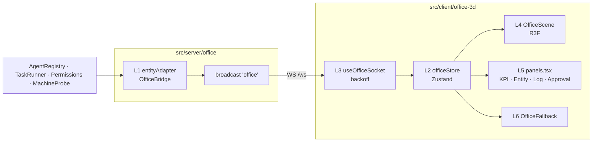

# Văn phòng 3D hợp nhất (`/office-3d/`)

Giao diện thứ hai của FunnyOVS, viết bằng **React + React Three Fiber + Zustand**, chạy song song với giao diện cổ điển (`/`).
Cả hai dùng chung một server; giao diện cổ điển **không bị sửa hành vi** nên có thể quay lại bất cứ lúc nào.

## Chạy

```bash
npm run dev          # Vite :5173 + API :8787
# mở http://localhost:5173/office-3d/
npm run build && npm start   # bản production: http://localhost:8787/office-3d/
```

Trong app desktop: menu **Giao diện → Văn phòng hợp nhất / Cổ điển** (nhớ lựa chọn của bạn).

Tham số URL hữu ích: `?hour=22` (ép giờ để xem ngày/đêm), `?fallback=1` (ép bảng danh sách thay vì 3D).

## Kiến trúc



| Lớp | File | Ghi chú |
|---|---|---|
| Schema | `src/shared/officeEntity.ts` | `OfficeEntity` (zod), `OfficeEvent` (union), `isOfficeEvent` |
| L1 Adapter | `src/server/office/entityAdapter.ts`, `machine.ts` | Dịch sự kiện cũ → `OfficeEvent`; đọc CPU/RAM/tiến trình (chỉ đọc) |
| Server | `src/server/main.ts` | `broadcast()` phát cả sự kiện cũ lẫn `office`; `GET /api/office/entities`; snapshot khi kết nối |
| L2 Store | `src/client/office-3d/store/officeStore.ts` | Reducer thuần `applyOfficeEvent` |
| L3 Realtime | `src/client/office-3d/realtime/useOfficeSocket.ts` | Backoff 1s→30s, banner mất kết nối, "Thử lại ngay" |
| L4 Renderer | `src/client/office-3d/renderer/OfficeScene.tsx` | R3F bọc các module three.js sẵn có (`assets/decor`, `officeParts`, `effects`, `behavior`, `navgrid`) |
| L5 UI | `src/client/office-3d/ui/panels.tsx` | KPI, chi tiết thực thể, nhật ký, hộp duyệt (quyền thư mục + token), điều hướng phòng |
| L6 Fallback | `src/client/office-3d/fallback/OfficeFallback.tsx` | Không WebGL / mất ngữ cảnh / lỗi dựng 3D / `?fallback=1` |

### Luồng dữ liệu
1. Server giữ nguyên các sự kiện cũ (`agent:update`, `task:update`...). `broadcast()` đồng thời đưa chúng qua `OfficeBridge.translate()`.
2. Client nhận khung `{event:"office", data: OfficeEvent}`, kiểm tra bằng `isOfficeEvent`, rồi đưa vào store.
3. Cảnh 3D **không gọi API**; nó đăng ký store và đồng bộ nhân vật/bàn/màn hình theo thực thể.
4. Duyệt quyền/token gọi lại đúng REST cũ (`/api/permissions/decide`, `/api/tasks/:id/approve|reject`).

### Trạng thái
Schema chung là tập cha của 7 trạng thái FunnyOVS và 5 trạng thái đơn giản: `idle, working, researching, learning, pending-approval, blocked, error, offline, stopped`.
`simplifyStatus()` gộp về 5 trạng thái cho KPI.

## Hành vi trong cảnh
- **Nghỉ giải lao:** agent rảnh lâu chọn ngẫu nhiên từ `IDLE_ACTIONS` (`behavior.ts`): việc nhỏ tại chỗ hoặc đi (cà phê ở cửa, đài phun nước, ghế đá) bằng **A\*** (`navgrid.ts`). Điểm quá xa (> `MAX_WALK`) bị đổi thành việc tại chỗ.
- **Ngày/đêm** theo giờ máy, **bong bóng thoại**, **pháo giấy** khi xong việc, vòng cảnh báo khi bị chặn/chờ duyệt.
- **Máy tính** (`kind: machine`) hiện ở tủ server Phòng Đội AI với CPU/RAM thật. Chỉ đọc — không dừng/đóng tiến trình.

## Thêm một loại thực thể mới
1. Thêm giá trị vào `ENTITY_KINDS` (`src/shared/officeEntity.ts`).
2. Viết hàm `xxxToEntity()` + nhánh trong `OfficeBridge` (`entityAdapter.ts`), thêm test trong `tests/office.test.ts`.
3. Hiển thị: thêm nhánh trong `EntitiesLayer` (`OfficeScene.tsx`) và phần chi tiết trong `EntityPanel`.
4. Fallback tự hiện hàng mới vì đọc cùng store (thêm kind vào danh sách trong `OfficeFallback.tsx` nếu cần).

## Thêm một renderer mới
Renderer chỉ cần: đọc `useOfficeStore`, gọi `select(id)` / `focusOn(x, z)`, và không tự gọi API. Thay `OfficeScene` trong `App.tsx`
(đã tải lười) — các lớp L1–L3 và L5 giữ nguyên.

## Rollback
- Dừng dùng: mở `/` (giao diện cổ điển) hoặc chọn **Giao diện → Cổ điển** trong app. Server vẫn phát sự kiện cũ nên không mất gì.
- Gỡ hẳn: xoá `src/client/office-3d/`, `src/server/office/`, `src/shared/officeEntity.ts`; trong `main.ts` bỏ khối "Văn phòng hợp nhất" và hàm `broadcastOffice`;
  trong `vite.config.ts` bỏ mục `office3d` khỏi `rollupOptions.input`. Giao diện cổ điển vẫn chạy (dùng `behavior.ts`/`decor.ts` chung).

## Kiểm thử
```bash
npm run typecheck && npm test && npm run build
```
Thủ công: mở `/office-3d/` → thấy 8 nhân viên + máy với số liệu thật → bấm nhân vật/tủ server xem chi tiết → tắt server (banner "Mất kết nối… thử lại sau Ns") →
bật lại (banner biến mất, snapshot khôi phục) → `?fallback=1` hiện bảng. Giả lập sự kiện: `window.__office.getState().apply({...})` (xem `tests/office3d.test.ts`).

## Giới hạn hiện tại
- Thực thể `task` có trong store, KPI và bảng dự phòng nhưng **chưa vẽ** trong cảnh 3D.
- Chưa có model Kenney (tải thủ công từ kenney.nl rồi `npm run scan:assets`); cảnh dùng hình dựng bằng code.
- Giao diện cổ điển còn sao chép một phần mã dựng phòng với `assets/officeParts.ts`; khi bỏ bản cổ điển nên gộp lại.
