# Văn phòng 3D hợp nhất (`/office-3d/`)

Giao diện thứ hai của FunnyOVS, viết bằng **React + React Three Fiber + Zustand**, chạy song song với giao diện cổ điển (`/`).
Cả hai dùng chung một server; giao diện cổ điển **không bị sửa hành vi** nên có thể quay lại bất cứ lúc nào.

## Chạy

```bash
npm run dev          # Vite :5173 + API :8787
# mở http://localhost:5173/office-3d/
npm run build && npm start   # bản production: http://localhost:8787/office-3d/
```

Trong app desktop: menu **Giao diện → Văn phòng hợp nhất / Cổ điển** (nhớ lựa chọn của bạn).

Tham số URL hữu ích: `?hour=22` (ép giờ để xem ngày/đêm), `?fallback=1` (ép bảng danh sách thay vì 3D).

## Kiến trúc

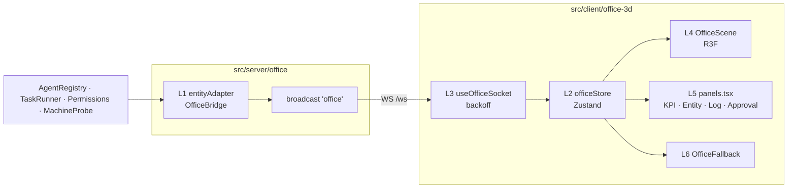

| Lớp | File | Ghi chú |
|---|---|---|
| Schema | `src/shared/officeEntity.ts` | `OfficeEntity` (zod), `OfficeEvent` (union), `isOfficeEvent` |
| L1 Adapter | `src/server/office/entityAdapter.ts`, `machine.ts` | Dịch sự kiện cũ → `OfficeEvent`; đọc CPU/RAM/tiến trình (chỉ đọc) |
| Server | `src/server/main.ts` | `broadcast()` phát cả sự kiện cũ lẫn `office`; `GET /api/office/entities`; snapshot khi kết nối |
| L2 Store | `src/client/office-3d/store/officeStore.ts` | Reducer thuần `applyOfficeEvent` |
| L3 Realtime | `src/client/office-3d/realtime/useOfficeSocket.ts` | Backoff 1s→30s, banner mất kết nối, "Thử lại ngay" |
| L4 Renderer | `src/client/office-3d/renderer/OfficeScene.tsx` | R3F bọc các module three.js sẵn có (`assets/decor`, `officeParts`, `effects`, `behavior`, `navgrid`) |
| L5 UI | `src/client/office-3d/ui/panels.tsx` | KPI, chi tiết thực thể, nhật ký, hộp duyệt (quyền thư mục + token), điều hướng phòng |
| L6 Fallback | `src/client/office-3d/fallback/OfficeFallback.tsx` | Không WebGL / mất ngữ cảnh / lỗi dựng 3D / `?fallback=1` |

### Luồng dữ liệu
1. Server giữ nguyên các sự kiện cũ (`agent:update`, `task:update`...). `broadcast()` đồng thời đưa chúng qua `OfficeBridge.translate()`.
2. Client nhận khung `{event:"office", data: OfficeEvent}`, kiểm tra bằng `isOfficeEvent`, rồi đưa vào store.
3. Cảnh 3D **không gọi API**; nó đăng ký store và đồng bộ nhân vật/bàn/màn hình theo thực thể.
4. Duyệt quyền/token gọi lại đúng REST cũ (`/api/permissions/decide`, `/api/tasks/:id/approve|reject`).

### Trạng thái
Schema chung là tập cha của 7 trạng thái FunnyOVS và 5 trạng thái đơn giản: `idle, working, researching, learning, pending-approval, blocked, error, offline, stopped`.
`simplifyStatus()` gộp về 5 trạng thái cho KPI.

## Phân tầng công ty

17 nhân viên theo 3 tầng (`src/server/agents/agentRegistry.ts`, dữ liệu thuần): **Giám đốc** (Hùng, ngồi ở **Phòng Giám đốc** — phòng góc, có sofa tiếp khách) → **8 Trưởng phòng** (giữ id cũ: mai, long, huy, thu, ban, an, tri, minh) → **8 Nhân viên** (mỗi phòng một người). Trong phòng, trưởng phòng ngồi bên trái, nhân viên bên phải, cùng một hàng.

```
Bạn ──► Giám đốc ──► Trưởng phòng (mỗi phòng liên quan) ──► Nhân viên (ít việc nhất)
          ▲                │                                    │
          └── nghiệm thu ◄─┴──────────── kết quả ◄──────────────┘
```

- **Giao việc:** tab *Tổ chức* → chọn người nhận (mặc định Giám đốc) → *Giao việc* (hoặc `POST /api/org/assign {prompt, toAgentId}`). Ai cũng có thể được giao thẳng: giao cho trưởng phòng thì bỏ qua Giám đốc, giao cho nhân viên thì tự làm.
- **Tách việc** (`src/server/org/planner.ts`): Giám đốc lập kế hoạch bằng **LLM** — trả về JSON được kiểm bằng schema zod (tối đa 6 bước, 4 phòng, `dependsOn` chỉ trỏ về bước trước nên không có vòng).
  Có nhà cung cấp AI thì dùng LLM, lỗi/trả sai định dạng/quá hạn/không có AI thì **tự quay về bộ định tuyến từ khoá** (`orgChart.ts`, không tốn token). Nút gốc ghi `planSource` ("AI lập kế hoạch" / "Theo từ khoá") và mỗi bước có `rationale`.
- **Bước phụ thuộc:** bước có `dependsOn` chờ các bước trước xong; kết quả của chúng được đưa vào lời giao việc của bước sau. Việc lỗi được **thử lại một lần với người khác** trong phòng (trừ lỗi xác định như hết ngân sách/chưa có AI).
- **Chọn người làm:** nhân viên ít việc nhất; nếu mọi nhân viên bận (≥ 2 việc) mà trưởng phòng rảnh hơn thì trưởng phòng tự làm.
- **Nghiệm thu** (`src/server/org/dispatcher.ts`): mỗi cấp chờ cấp dưới xong rồi gom thành **dữ liệu có cấu trúc** (`review`: số xong/lỗi/từ chối + từng người) — client tự định dạng theo ngôn ngữ. Nút gốc có thêm **báo cáo tổng hợp** do Giám đốc viết bằng LLM (có dự phòng khi LLM lỗi). Một việc lỗi → cấp trên báo lỗi nhưng vẫn kèm kết quả các việc đã xong.
- **An toàn giữ nguyên:** nút *delegation* (Giám đốc/Trưởng phòng) chỉ phân việc; nút *work* là việc thật đi qua `TaskRunner` nên ước lượng, duyệt trước khi tốn token, ngân sách và dừng khẩn cấp vẫn áp dụng. Độ sâu cố định 3 tầng, chỉ đi xuống (không vòng lặp giao việc).
- **Trong cảnh 3D:** tờ giấy bay từ bàn cấp trên xuống bàn cấp dưới khi giao việc (xanh = tới trưởng phòng, vàng = tới nhân viên) và bay ngược (xanh lá) khi báo cáo xong; người giao đưa tay chỉ, người nhận giơ tay; **khi Giám đốc chia việc cho ≥ 2 phòng thì họp** (xem "Cơ sở vật chất và nhân vật").
- **Báo cáo tải về** (`ui/flowReport.ts`): luồng đã kết thúc có nút *Tải báo cáo (.md)* — tệp Markdown gồm tiêu đề, trạng thái + số đếm, **tóm tắt của Giám đốc** và **kết quả (hoặc lỗi đã dịch) của từng người**, theo ngôn ngữ đang chọn.
  Sinh ngay trên trình duyệt (không qua máy chủ, không gửi đi đâu). Nội dung do AI viết được **trích dẫn** (`> `) nên tiêu đề/khối mã trong đó không phá cấu trúc báo cáo; tên tệp bỏ dấu tiếng Việt, chỉ `a-z0-9-`, có ngày (`funnyovs-report-<tiêu-đề>-2026-11-22.md`).
- **Độ bền:** cây giao việc lưu ở `org.json` (xem "Bảo mật cục bộ & độ bền"). Mỗi lần một nút có thêm con, server **phát lại cả nút cha** để client không giữ danh sách con cũ.

## Kết nối AI (tự động)

`src/server/ai/*` — lớp OpenAI-compatible duy nhất cho mọi nơi cần LLM (lập kế hoạch, báo cáo, agent chạy việc thật).

- **Tự dò (không cần cấu hình):** OmniRoute / [9router](https://github.com/decolua/9router) `:20128` (cổng gom nhiều nguồn miễn phí, model `auto`; hai cổng dùng chung một mục vì cùng cổng và đường dẫn `/v1`), Ollama `:11434`, LM Studio `:1234`. Đổi địa chỉ bằng `OFFICE_OMNIROUTE_URL`, `OLLAMA_HOST`.
  Nút *Khởi động* ở tab **AI** thử chạy `omniroute` rồi `9router` nếu đã cài (`npm i -g 9router`); khoá của cổng lấy ở Dashboard → Settings → API Keys rồi dán vào ô khoá.
- **Khoá miễn phí:** tự nhận từ biến môi trường (`GROQ_API_KEY`, `GEMINI_API_KEY`, `CEREBRAS_API_KEY`, `MISTRAL_API_KEY`, `OPENROUTER_API_KEY` — chỉ model `:free`, `NVIDIA_API_KEY` (NVIDIA NIM), `SAMBANOVA_API_KEY`) hoặc dán trong tab **AI**; mỗi nguồn có liên kết tới trang lấy khoá (app **không tự đăng ký tài khoản/khoá** thay bạn — việc đó cần người thật và điều khoản của từng dịch vụ). GitHub Models đã bị GitHub ngừng từ 30/7/2026 nên không còn trong danh mục. Khoá lưu file quyền 0600, **không bao giờ trả về client** (chỉ bản che), và mọi thông điệp lỗi/nhật ký đi qua `redact()`.
- **Nút "+ Thêm API" (gom như 9router)** (`ai/custom.ts`, `ai/hub.ts`, `ui/AiPanel.tsx`): thêm **bất kỳ điểm cuối tương thích OpenAI** (Together, DeepSeek, vLLM/LiteLLM trong mạng nội bộ, một khoá thứ hai của cùng nhà cung cấp để gộp hạn mức…) — tối đa 20 nguồn.
  Có thể chọn **mẫu dựng sẵn** (điền sẵn tên + địa chỉ). Bấm *Kiểm tra* gọi thật `/models` trước khi lưu và báo rõ lý do nếu khoá bị từ chối, địa chỉ sai hoặc không có danh sách model; địa chỉ chỉ nhận `http/https`, không kèm tài khoản, bỏ query/hash.
  Nguồn tuỳ chỉnh được **sửa/xoá**, **sắp thứ tự bằng mũi tên** (áp dụng cho cả nguồn dựng sẵn) và chọn **chiến lược**: *dự phòng theo thứ tự* (mặc định) hoặc *xoay vòng* (chia đều tải/hạn mức giữa các nguồn đang sẵn sàng). Khoá lưu ở kho khoá `0600` (`ai.<id>.key`), danh sách nguồn ở `ai.json` **không có khoá**.
  REST (chỉ từ chính máy — `loopbackOnly`): `POST /api/ai/custom/check`, `POST /api/ai/custom`, `PATCH|DELETE /api/ai/custom/:id`, `PUT /api/ai/order`, `PUT /api/ai/strategy`; mỗi thay đổi ghi vào nhật ký bảo mật (`ai.provider.add|edit|remove`, `ai.order`, `ai.strategy`) **không kèm khoá**.
- **Router:** thử lần lượt theo ưu tiên (hoặc xoay vòng nếu chọn); lỗi liên tiếp → ngắt mạch (15s → tối đa 5 phút); 429 tôn trọng `Retry-After`; 401/403 nghỉ 10 phút và báo "khoá bị từ chối"; 404 vì sai model → dò lại `/models` và thử một lần; 400 vì `response_format` → thử không JSON mode.
- **Backend chạy việc** (cấu hình `llmBackend` qua `PUT /api/config`: `auto|router|cursor-agent|rule`): `auto` ưu tiên router, rồi Cursor nếu đã đăng nhập, rồi quy tắc. Mức dùng token của router được ghi vào sổ cái (nguồn `provider-usage`).
- **Chạy thử không tốn token:** `node scripts/mock-llm.mjs` (giả Ollama trên `:11434`) + `npm run preview` (máy chủ cách ly, dữ liệu tạm) → giao việc cho Giám đốc và xem trọn luồng: kế hoạch → trưởng phòng → nhân viên dùng CRM/ghi file → nghiệm thu → báo cáo.

## Kinh tế tự trị (EAL, tuỳ chọn)

`src/server/economy/*` — bán báo cáo qua paywall, sổ cái băm nối, vòng lặp lãi/lỗ, Scout chỉ đề xuất. **Mặc định tắt** (`ECONOMY_RAIL`). Chi tiết kiến trúc, cấu hình, rủi ro và tiêu chí nghiệm thu: [`economy-layer.md`](economy-layer.md); mô phỏng 30 ngày: [`economy-backtest.md`](economy-backtest.md).
Trong cảnh 3D: **bảng KPI** trên tường lưng Phòng Tài chính (`assets/economyBoard.ts`, vẽ lại chỉ khi số liệu đổi) và thẻ "Kinh tế tự trị" ở tab *Tổng quan*; hộp duyệt (xuất bản / cơ hội / tái đầu tư) hiện như mọi hành động ra ngoài. Sự kiện kinh tế đi qua schema chung (`economy.state`, `economy.event`; móc kiểm tra `window.__officeEconomy()`).
Điểm khác thường cần biết: sản phẩm trả phí chạy ở **cổng công khai riêng** (`ECONOMY_PUBLIC_PORT`) chỉ có 3 đường dẫn — tuyệt đối không đưa tunnel vào cổng chính, vì API chính coi yêu cầu từ loopback là chính chủ.

## Công cụ thật cho nhân viên

`src/server/agent/*` — bộ chạy ReAct (`executor.ts`): mô hình trả **một JSON mỗi lượt** (`{"tool","args"}` hoặc `{"final"}`) nên chạy được cả trên model miễn phí không có function-calling.
Giới hạn bước/thời gian, phát hiện lặp, kết quả công cụ luôn được bọc là **dữ liệu không tin cậy** (không làm theo chỉ dẫn trong đó).

| Nhóm | Công cụ | Ghi chú an toàn |
|---|---|---|
| File | `fs_list`, `fs_read`, `fs_write` | Qua `GuardedFs`: thư mục workspace, xin quyền khi ra ngoài |
| Web | `web_fetch` | Chặn SSRF: IP nội bộ, redirect, DNS (ghim IP), giới hạn dung lượng |
| Tri thức | `kb_search`, `kb_save` | Thư viện tri thức cục bộ |
| CRM | `crm_search`, `crm_upsert_contact`, `crm_add_deal`, `crm_move_deal`, `crm_log`, `crm_summary` | SQLite cục bộ (`crm/store.ts`); hiển thị ở tab CRM |
| Email | `email_draft`, `email_send`, `email_inbox` | SMTP/IMAP thật; **gửi chỉ sau khi bạn duyệt** (`ActionGate`, yêu cầu hết hạn sau 10 phút) |
| Lịch | `calendar_add`, `calendar_list` | Xuất `.ics` |
| GitHub | `github_issues`, `github_issue_create` | Tạo issue cần duyệt |

Danh sách công cụ **theo vai trò** (`TOOL_POLICY`): phòng Tài chính không có `email_send`, phòng Marketing không có `crm_add_deal`... Chế độ *Hỏi*/*Kế hoạch* chỉ cho công cụ đọc.

## Truy cập qua mạng LAN và token

Mặc định chỉ chính máy này truy cập được. Cài đặt → **Truy cập từ máy khác (LAN)** bật chế độ LAN (cần khởi động lại): server nghe `0.0.0.0`, chấp nhận `Host` là IP riêng/`.local`,
và máy khác **bắt buộc có mã truy cập** (header `Authorization: Bearer`, `X-FunnyOVS-Token`, cookie, hoặc `?token=` lần đầu rồi đổi thành cookie `HttpOnly; SameSite=Strict` và chuyển hướng để token không nằm lại trên URL).
So sánh token hằng thời gian, giới hạn 10 lần sai/phút theo địa chỉ, WebSocket cũng kiểm. Các thao tác nhạy cảm (dán khoá AI, cấu hình email/GitHub, xem/đổi token, bật LAN) **chỉ nhận từ chính máy chạy ứng dụng** (mã `loopbackOnly`).

## Nhật ký bảo mật, sao lưu, việc lặp lại

- **Nhật ký bảo mật** (`security/audit.ts`, `<dữ liệu>/audit.log`): chỉ ghi thêm, mỗi dòng một JSON, quyền `0600`, xoay vòng ở 1 MB. Ghi: đặt/xoá khoá AI, đổi cấu hình email/GitHub, bật/tắt LAN, đổi mã truy cập,
  duyệt/từ chối/hết hạn hành động, email đã gửi, dừng khẩn cấp, xuất/khôi phục sao lưu, tạo/xoá/chạy việc lặp lại. **Không bao giờ chứa bí mật** (khoá, mật khẩu, nội dung email — chỉ loại hành động, người xin, đích). Xem ở Cài đặt → Nhật ký bảo mật (`GET /api/audit`, chỉ từ chính máy).
- **Sao lưu / khôi phục** (`backup/backup.ts`, Cài đặt → Sao lưu & khôi phục): xuất một tệp JSON gồm CRM, lịch, email nháp, cây giao việc, việc lặp lại — **không có khoá AI/mật khẩu**.
  Khôi phục là **thay thế toàn bộ** nên có hộp xác nhận kèm số liệu của tệp; tệp được kiểm schema (zod) trước khi đụng vào dữ liệu hiện có, nhập trong một giao dịch (hỏng thì không ghi gì), từ chối khi đang có việc chạy (`409 backupBusy`),
  và luôn giữ bản sao dữ liệu hiện tại ở `<dữ liệu>/backups/pre-restore-*.json` (5 bản mới nhất, quyền `0600`). Chỉ nhận từ chính máy (`/api/backup`, `/api/backup/restore`).
- **Việc lặp lại** (`schedule/scheduler.ts`, tab *Tổ chức* → Việc lặp lại): hằng ngày hoặc hằng tuần vào giờ máy, tối đa 50 lịch, lưu ở `<dữ liệu>/schedules.json`. Đến giờ thì giao cho người nhận (mặc định Giám đốc) **qua đúng đường giao việc thường**
  (ước lượng, duyệt, ngân sách). Lịch bị lỡ lúc tắt máy chạy bù **một lần** khi mở lại; **bỏ qua** khi đang dừng khẩn cấp; tạm dừng/bật lại không chạy bù những lần đã tắt. REST: `/api/schedules` (+ `/:id/run`, `PATCH`, `DELETE`).

## Hiệu năng và độ bền của giao diện

- **Chất lượng đồ hoạ Tự động / Cao / Thấp** (Cài đặt; mặc định *Tự động*). `AutoQualityMonitor` bỏ qua 4 giây khởi động (nạp asset, biên dịch shader), rồi đo thời gian khung trung bình theo cửa sổ 90 khung;
  > 40 ms (≈ 25 FPS) ở **2 cửa sổ liên tiếp** thì hạ xuống *Thấp* đúng một lần (không tự bật lên lại để khỏi nhấp nháy) và hiện thông báo kèm nút đổi lại. Khung hình quá dài do tab bị ẩn bị cắt trần nên không hạ oan.
  Mức *Thấp* tắt bóng đổ và giảm độ mịn hình học tóc/đầu nhân vật (`setChibiDetail`), nhẹ hơn ~60% số tam giác.
- **Ngân sách dựng hình** đo được: `window.__officeStats()` trả số lệnh vẽ và số tam giác của cả cảnh. `scripts/verify-ui.mjs` kiểm bằng Chrome thật: mức *Cao* ≤ 1.800 lệnh vẽ và ≤ 1.000.000 tam giác; mức *Thấp* ≤ 450.000 và nhẹ hơn *Cao* ít nhất 45%.
- **Chịu được dữ liệu lạ:** phản hồi 200 không phải JSON (vd. máy chủ bản cũ trả `index.html` cho đường dẫn chưa có) thành lỗi rõ ràng (`ApiError badResponse`) thay vì làm vỡ `.map`; mỗi tab và cả trang có `ErrorBoundary` (thẻ lỗi + nút thử lại thay vì trắng màn hình).
- **Mất kết nối rồi hồi phục:** WebSocket tự nối lại với chờ tăng dần (1 s, 2 s, 4 s… tối đa 30 s) và nút *Thử lại ngay*; biểu ngữ báo mất kết nối **đẩy các khung xuống** thay vì đè lên tab/nút; khi nối lại được, các bảng tải định kỳ (CRM, AI, lịch…) **tải lại ngay** thay vì đợi vòng kế tiếp.

## Tiếp cận (a11y)

- Trang khai báo `lang` đúng ngôn ngữ đang chọn; mọi nút/ô nhập/liên kết có tên truy cập được; vùng 3D có mô tả (`aria-label`) và chỉ dẫn cách dùng danh sách bên trái thay cho việc bấm vào cảnh.
- **Hộp thoại** có `role="dialog"` + `aria-modal` + tên; Tab/Shift+Tab xoay vòng **bên trong** hộp thoại, Esc đóng và trả focus về nút đã mở nó.
- **Tab** theo mẫu ARIA tablist (←/→ xoay vòng, Home/End; chỉ tab đang chọn nằm trong thứ tự Tab; `aria-controls`/`aria-labelledby`) — cả tab chính lẫn thanh mục con của CRM.
- **Giao việc bằng bàn phím:** `Ctrl/⌘+Enter` trong ô nhập (không gửi khi đang gõ dở bằng bộ gõ Telex/VNI). Kết quả thao tác nằm trong vùng `role="status"` (luôn có mặt trong DOM), lỗi hiện bằng `role="alert"`.
- **Yêu cầu duyệt** (quyền thư mục, token, gửi email…): vùng `aria-live="assertive"` luôn có mặt đọc "Cần bạn duyệt: …" khi có yêu cầu **mới**; hộp duyệt đứng ngay sau thanh đầu trong thứ tự Tab nên tới được bằng vài lần Tab và duyệt bằng Enter.
- **Báo khi việc kết thúc:** vùng `aria-live="polite"` đọc "Work completed: …" / "Work failed: …" khi một luồng việc xong hoặc lỗi (chỉ luồng *vừa* đổi trạng thái, không đọc lại lịch sử khi tải trang) — người dùng trình đọc màn hình không nhìn thấy cảnh 3D nên cần được báo.
- **Tương phản:** mọi chữ đạt WCAG AA (4,5:1; chữ lớn 3:1; cả chữ gợi ý của ô nhập). `auditContrast` tính màu nền thật bằng cách chồng các lớp nền trong suốt; chữ nằm trên canvas 3D hay nền gradient được bỏ qua (không phán đoán), nút vô hiệu hoá được miễn theo WCAG.
- **Giảm chuyển động** (Cài đặt → Chuyển động: *Theo hệ điều hành* / *Đầy đủ* / *Giảm*; mặc định theo `prefers-reduced-motion`): khi giảm, cảnh 3D **không** có pháo giấy, vòng xung, tờ giấy bay, không đi họp hay nghỉ giải lao, vòng sáng không nhấp nháy, camera nhảy thẳng tới đích thay vì lượn; CSS tắt mọi chuyển tiếp/hoạt ảnh (`html[data-motion]`). Lựa chọn tay thắng cài đặt của hệ điều hành.
- `scripts/a11y-audit.mjs` quét các lỗi trên bằng DOM (không cần thư viện); `scripts/verify-ui.mjs` chạy nó (cùng đo tương phản) trên mọi tab và hộp thoại ở cả hai ngôn ngữ, rồi thử luồng chính chỉ bằng bàn phím, duyệt bằng Enter và quét chữ tiếng Việt lọt vào giao diện tiếng Anh.

## Đa ngôn ngữ cả phía server

Server **không gửi câu đã dịch**: nó gửi `key` + `vars` (kèm bản tiếng Việt dự phòng) và client dịch theo ngôn ngữ người dùng (`src/shared/messages.ts` là bảng dùng chung vi/en).
Áp dụng cho: duyệt quyền/token/hành động, lỗi tác vụ/Cursor/ngân sách/AI/API/xác thực, nghiệm thu, kiểm tra dữ liệu CRM/email/lịch, trạng thái và lỗi kết nối AI (`shared/aiErrors.ts`).
`$t:khoá` trong biến được dịch tiếp (vd. hành động "đọc"/"read"). Lời nhắc gửi LLM và câu trả lời mặc định cũng theo ngôn ngữ của yêu cầu. Test quét mã nguồn: mọi khoá dùng đều có ở cả hai ngôn ngữ và cùng biến.

## Cơ sở vật chất và nhân vật

- **Phòng tiện ích** (`src/shared/facilities.ts`, dữ liệu thuần — không nằm trong danh sách phòng ban nên bộ lập kế hoạch không bao giờ giao việc cho chúng): **Phòng họp** (bàn dài, 8 ghế, chỗ thuyết trình, màn hình hiện chủ đề đang họp), **Pantry** (quầy, máy cà phê, tủ lạnh, máy bán hàng, bàn tròn), **Sảnh lễ tân** (quầy, logo công ty theo tên bạn đặt, khu chờ, bảng tin số liệu thật). Một nguồn dữ liệu cho hình dựng, lưới đường đi A* và test.
- **Bộ phòng kiểu chibi** (`assets/chibiProps.ts`, `assets/workstation.ts`): mọi phòng — phòng ban, Giám đốc, họp, pantry, sảnh, thư viện — dùng chung một ngôn ngữ đồ đạc mềm, bo tròn để hợp với nhân vật chibi (`softBox` = hộp bo tròn, cache theo kích thước, 2 mức chi tiết).
  **Bàn làm việc** (`buildWorkstation`): mặt bàn bo tròn có mép màu phòng, hộc kéo, thảm bàn, bàn phím/chuột, cốc (màu theo người), chậu cây, **một món đồ riêng theo từng người** (đèn / tai nghe / mèo / chồng sách, chọn ổn định theo id), màn hình bo tròn có **huy hiệu phòng** ở lưng, ghế xoay màu phòng (Giám đốc: ghế lưng cao + gối tựa vàng).
  **Mỗi phòng có bản sắc màu riêng**: ốp chân tường (wainscot) + viền màu phòng, khung tranh; thư viện có kệ sách rỗng với gáy sách màu; sofa, quầy lễ tân, bếp pantry, tủ lạnh, máy bán hàng, tủ server… đều bo tròn.
  Toàn bộ được **gộp theo vật liệu** (≈ 10 lệnh vẽ/bàn) nên nhẹ hơn bản cũ dù chi tiết hơn; hình học có/không có chỉ mục (hộp bo tròn không có, hộp/trụ/cầu thì có) được thống nhất trước khi gộp. Ngân sách dựng hình vẫn nằm trong ngưỡng đã nêu ở trên (mức *Cao* ≈ 1.320 lệnh vẽ / 0,93 triệu tam giác).
- **Toà nhà liền** (`BUILDING` trong `src/shared/facilities.ts`, dựng ở `assets/building.ts`): mọi phòng nằm trong **một công trình** có tường ngoài bao quanh (chân tường đặc + kính trong suốt + cột chia ô + dầm ở ba mặt bắc/tây/đông; tường nam chỉ là chân tường thấp để camera nhìn vào được),
  **một cửa chính** ở tường nam ngay trước mặt sảnh lễ tân (lối lát + hai chậu cây), **hành lang** là sàn đá sáng phủ khắp toà nhà giữa các phòng với **thảm chỉ đường màu phòng** trước cửa từng phòng, và **hai sân trong** (vườn có cây, bụi, viền đá) ở phần trống phía bắc.
  Phòng **không đổi chỗ** nên lưới đường đi A*, họp, pantry và hành vi cũ giữ nguyên; lưới chỉ thêm tường ngoài làm vật cản (chừa cửa chính). Cây, đèn đường nằm ngoài tường. Test: `tests/facilities.test.ts` › "toà nhà liền".
- **Sàn riêng từng khu** (`assets/floors.ts`): gỗ / thảm / gạch bằng texture sinh sẵn. **Ban đêm** đèn phòng sáng hơn và cửa sổ, đèn cây, máy bán hàng, LED phát sáng (`setNight` trong `decor.ts`).
- **Việc đang chạy hiện ngay trong cảnh** (`assets/workboard.ts`, hàm thuần kiểm thử được): **bảng việc sống** phủ lên bảng roadmap ở phòng *Giao việc* — tối đa 3 luồng (đang mở trước, rồi luồng vừa xong trong 30 phút), mỗi luồng có trạng thái
  (đang chạy / chờ duyệt / xong / lỗi), thanh tiến độ (việc thật đã xong / tổng), người đang cầm việc; ba số đếm ở đầu bảng; bảng trống có gợi ý. Chữ do client dịch nên đúng ngôn ngữ đang chọn và vẽ lại khi đổi ngôn ngữ. **Huy hiệu số việc mở** ở góc phải trên màn hình bàn của người phụ trách
  (cả người phân việc như Giám đốc/Trưởng phòng): xanh = đang mở, vàng = có việc chờ duyệt, đỏ "!" = có việc vừa lỗi (tự hết hạn sau 30 phút), "9+" khi từ 10 việc; không có việc thì ẩn; đặt xa nhân vật nên không che người. Hai móc kiểm tra: `window.__officeBoard()`.
- **Hành vi** (`assets/behavior.ts`): cà phê đi **pantry** khi đủ gần (nhiều chỗ đứng, không ai đứng chồng lên nhau), không thì rơi về cửa phòng; xem bảng tin sảnh; **phản ứng** nhận việc (giơ tay) / giao việc (đưa tay chỉ); **họp** — khi Giám đốc chia việc cho ≥ 2 phòng, Giám đốc thuyết trình và các trưởng phòng ngồi nghe rồi ai về chỗ nấy (việc "đang làm" không cắt ngang họp; giới hạn đi bộ riêng `MAX_WALK_MEETING`).
- **Persona** (`src/shared/personas.ts`): mỗi nhân viên một ngoại hình **ổn định theo id** (tóc, da, kiểu tóc, phụ kiện, màu áo), không ai trùng ai; **trang phục theo tầng**: Giám đốc vest + cà vạt vàng, Trưởng phòng sơ mi + cà vạt màu phòng, Nhân viên thường phục; **huy hiệu** ngực màu phòng ban. Xem cả công ty một lượt tại `/office-3d/sheet.html` (`?only=giamdoc,mai`, `?anim=hand`).
- **Tư thế theo trạng thái:** làm việc gõ phím, chờ duyệt giơ tay, bị chặn đổ mồ hôi, nghiên cứu/học đọc, xong việc ăn mừng. Test kiểm mọi tên pose dùng trong mã đều là nhánh thật của rig.

## Ảnh chụp

Chụp bằng `scripts/shot-ui.mjs` trên máy chủ cách ly + LLM giả chậm (`node scripts/demo-server.mjs`), nên thấy được lúc việc còn đang chạy.

| | |
|---|---|
| **Toàn cảnh khi đang giao việc:** Giám đốc đang họp (bảng phòng họp hiện chủ đề), luồng việc chạy xuống từng cấp ở tab *Tổ chức*, số việc mở cạnh tên người | 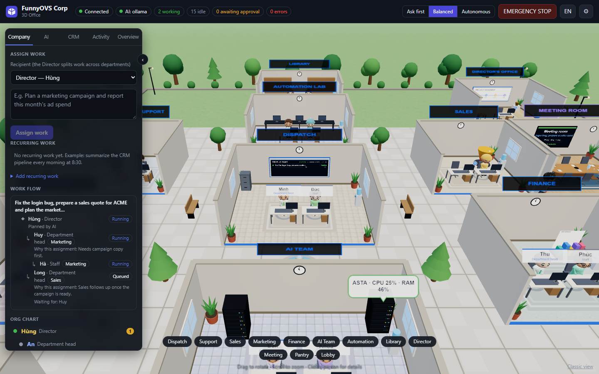 |
| **Bảng việc sống ở phòng Giao việc** (tiếng Anh): luồng, trạng thái, tiến độ, người đang làm | 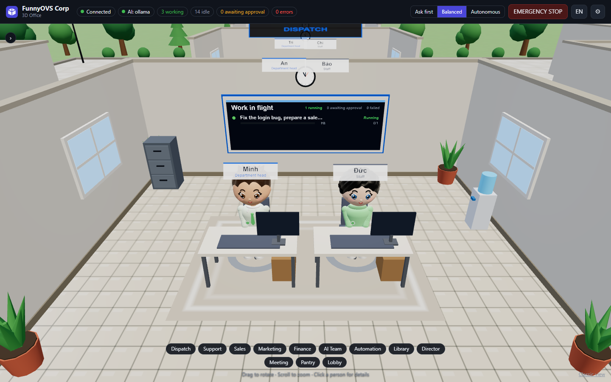 |
| **Cùng bảng ở tiếng Việt** — chữ do client dịch nên đổi theo ngôn ngữ | 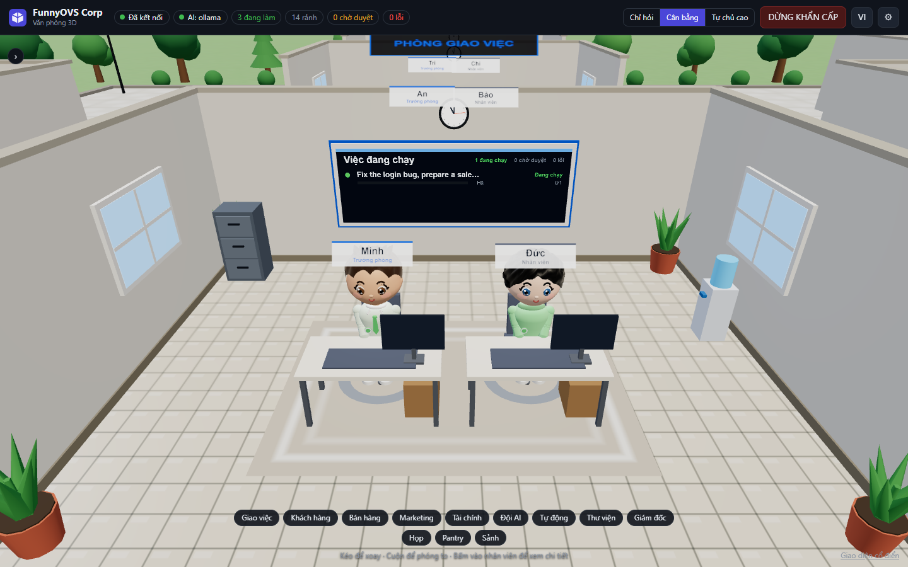 |
| **Huy hiệu số việc mở** ở góc màn hình bàn (xanh = đang mở) — xa nhân vật nên không che người | 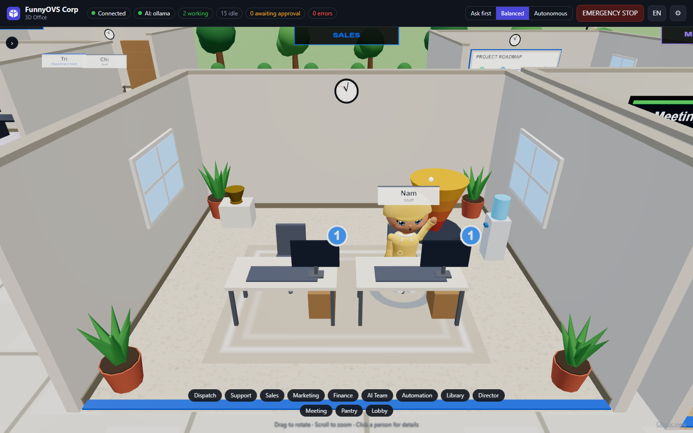 |
| **Cài đặt:** chuyển động, chất lượng đồ hoạ, riêng tư, LAN, email… | 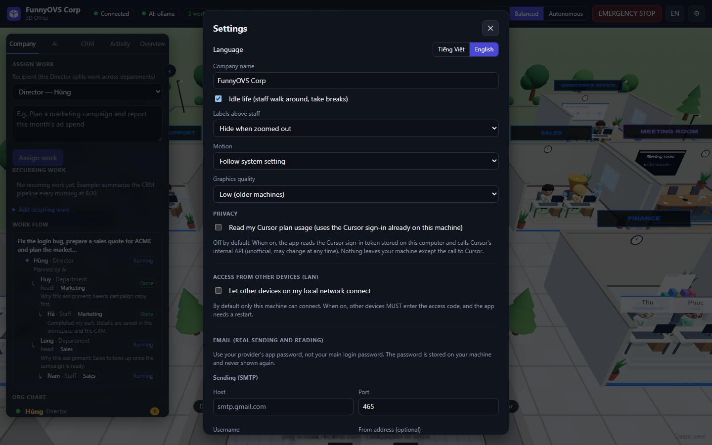 |
| **Bộ phòng kiểu chibi — toàn cảnh:** mỗi phòng một màu riêng (ốp chân tường, viền, khung tranh), bàn bo tròn, ghế màu phòng | 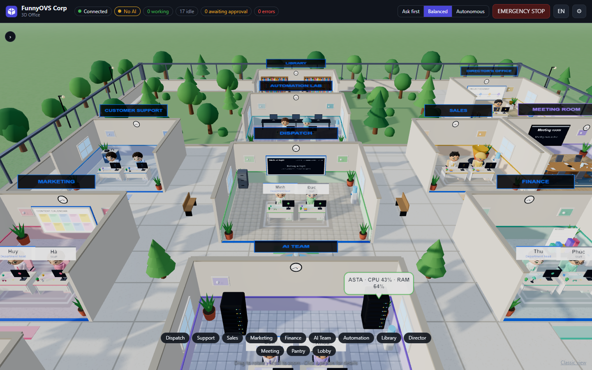 |
| **Toà nhà liền nhìn từ trên cao:** tường ngoài bao mọi phòng, hai sân trong ở phía bắc, hành lang giữa các phòng | 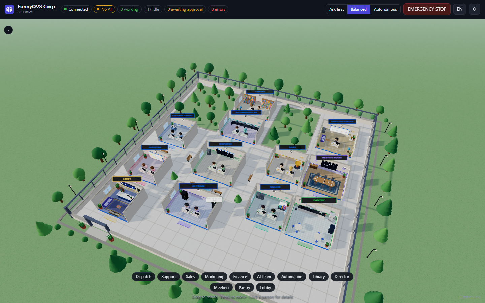 |
| **Cửa chính** ngay trước sảnh lễ tân, lối lát và chậu cây | 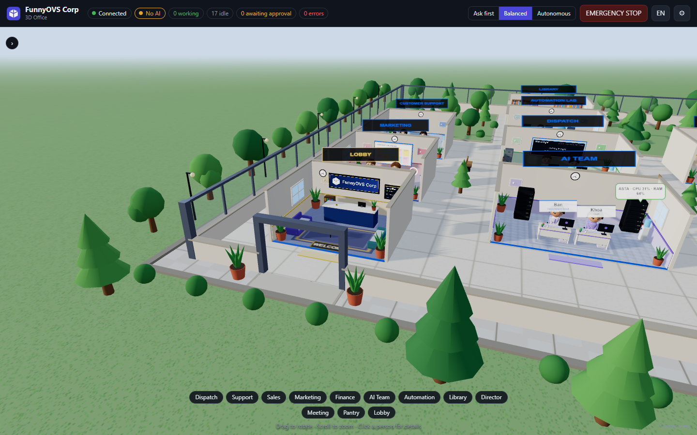 |
| **Bảng KPI Lớp kinh tế** ở Phòng Tài chính (rail giả, dữ liệu thử): đã thu / chi phí / lãi lỗ, chu kỳ gần nhất, cơ hội chờ duyệt | 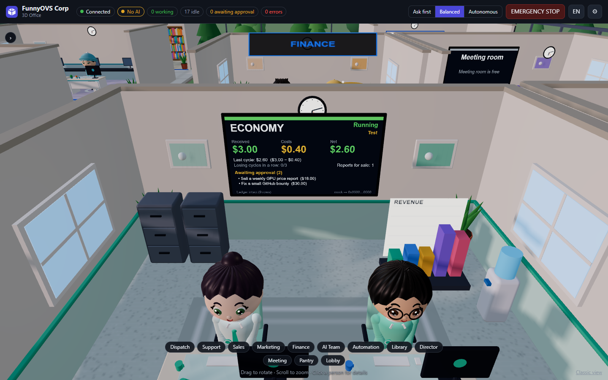 |
| **Phòng Hỗ trợ khách hàng:** bàn chibi — mép màu phòng, thảm bàn, bàn phím, cốc, chậu cây, huy hiệu phòng ở lưng màn hình | 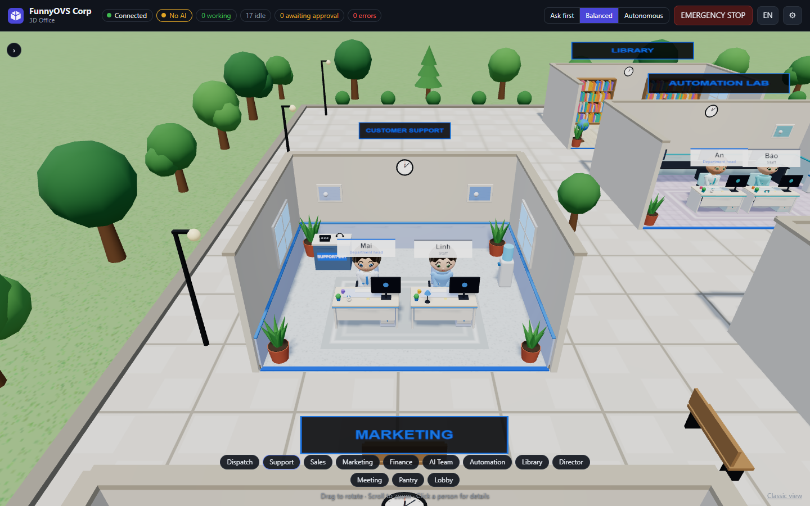 |
| **Sảnh lễ tân:** quầy và sofa bo tròn, ốp tường vàng, thảm "WELCOME" | 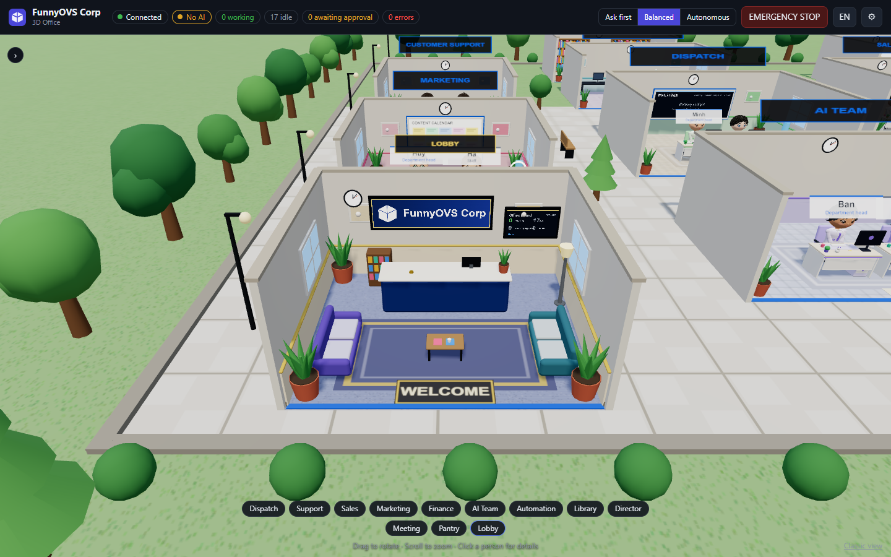 |
| **Pantry:** quầy bếp, tủ lạnh, máy bán hàng bo tròn, ghế đẩu | 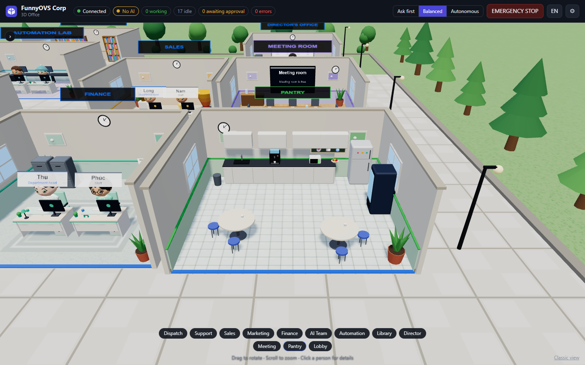 |
| **Tab AI → "+ Thêm API":** mẫu dựng sẵn, kiểm tra thật, nguồn tuỳ chỉnh gom vào chung bộ định tuyến (mũi tên thứ tự, dự phòng/xoay vòng) | 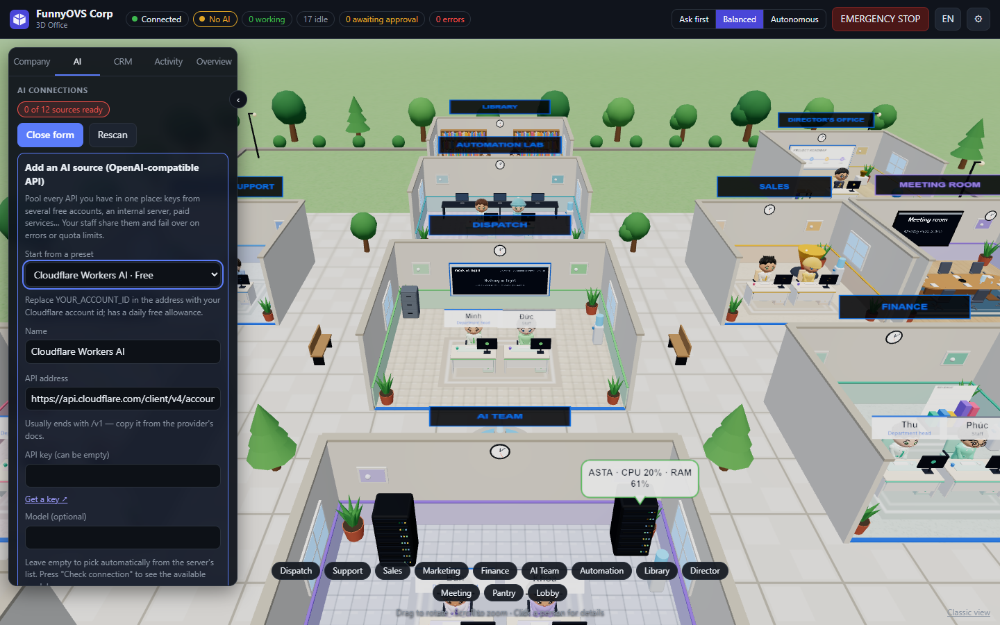 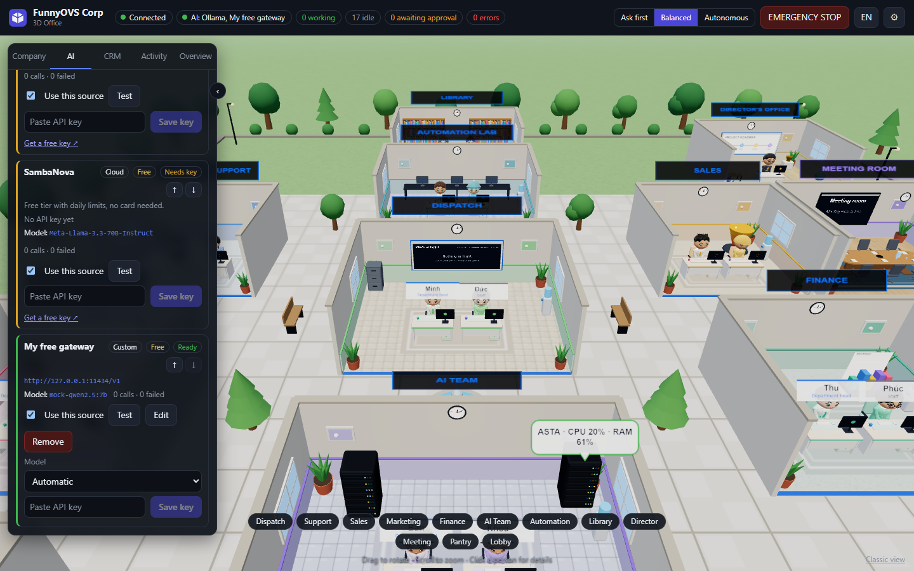 |

## Công cụ phát triển

| Lệnh | Việc |
|---|---|
| `npm run preview` | Máy chủ **cách ly** (cổng 8799, dữ liệu tạm) — không đụng dữ liệu thật |
| `node scripts/mock-llm.mjs` | LLM giả OpenAI-compatible (giả Ollama `:11434`) |
| `node scripts/shot-ui.mjs --tab ai --room Meeting --collapse --cam ... --assign "..."` | Chụp ảnh độ phân giải cao bằng Chrome có sẵn (xem đầu file để biết tuỳ chọn) |
| `node scripts/verify-ui.mjs` | Kiểm giao diện bằng **Chrome thật** trên máy chủ cách ly + LLM giả: AI, CRM, việc lặp lại, a11y, bàn phím, duyệt bằng phím, đa ngôn ngữ, sao lưu/khôi phục, ngân sách dựng hình, bảng việc sống + huy hiệu, **máy chủ chết rồi tự nối lại** (cần `npx vite build` trước) |
| `node scripts/verify-desktop.mjs` | Chạy bản đóng gói `release/win-unpacked/FunnyOVS.exe` thật qua CDP và kiểm (cần `npm run desktop:dir` trước) |
| `node scripts/demo-server.mjs` | Máy chủ cách ly + LLM giả **chậm** (cổng 8820) để xem/chụp lúc việc còn đang chạy |
| `node scripts/a11y-audit.mjs` | Thư viện quét a11y dùng trong `verify-ui` (`auditPage(page, { expectLang })`) |
| `npm run score` | Tính điểm từ `docs/07-diem-so.md` |

## Giao diện, ngôn ngữ, cài đặt

- **Thanh đầu:** tên công ty, trạng thái kết nối, số liệu nhanh (đang làm/rảnh/chờ duyệt/lỗi), mức tự động, DỪNG KHẨN CẤP, đổi ngôn ngữ (VI/EN), Cài đặt. Chấm **AI** (bấm mở tab kết nối; cảnh báo vàng khi chưa có AI). Dock trái có 5 tab: *Tổ chức*, *AI*, *CRM*, *Nhật ký*, *Tổng quan*; thu gọn được; tự thu gọn ở cửa sổ hẹp.
- **Đa ngôn ngữ vi/en** (`src/client/office-3d/i18n/`): mọi chữ giao diện, bong bóng thoại, biển phòng, màn hình trên bàn. Thêm ngôn ngữ = thêm một object cùng khoá vào `dictionaries.ts` (test `tests/i18n.test.ts` kiểm đủ khoá và khớp biến `{x}`). Chuỗi do server sinh cũng được dịch (xem "Đa ngôn ngữ cả phía server").
- **Lần đầu mở:** hộp thoại chào (chọn ngôn ngữ, đặt tên công ty, 3 bước giải thích). **Cài đặt** (⚙): ngôn ngữ, tên công ty, hoạt cảnh nhàn rỗi, nhãn trên đầu nhân viên (tự ẩn/luôn hiện/ẩn), chất lượng đồ hoạ (cao có đổ bóng / thấp), quyền riêng tư (đọc hạn mức Cursor — **tắt mặc định**), **truy cập từ máy khác (LAN + mã truy cập)**, **email SMTP/IMAP**, **token GitHub**, xem lại hướng dẫn. Lưu trong `localStorage`.

## Bảo mật cục bộ & độ bền
- `src/server/security/httpGuard.ts`: chỉ nhận `Host` loopback (chống DNS rebinding; mở thêm bằng `OFFICE_ALLOW_HOSTS=host1,host2`), kiểm tra `Origin` của WebSocket, CSP chặt cho `/office-3d/`, `X-Frame-Options`, `nosniff`.
- Cây giao việc lưu ở `<dữ liệu>/org.json` (ghi nguyên tử), nạp lại khi mở; việc đang chạy lúc tắt app được đánh dấu "gián đoạn"; gốc đã xong quá 7 ngày bị dọn.
- Electron: từ chối mọi quyền web, chặn `<webview>`, nhớ cửa sổ, nhật ký `logs/main.log`. Xem `docs/06-san-sang-thi-truong.md` để biết những gì còn thiếu trước khi bán.

## Hành vi trong cảnh
- **Nghỉ giải lao:** agent rảnh lâu (30–70 giây lần đầu, sau đó 1–2 phút) chọn ngẫu nhiên từ `IDLE_ACTIONS` (`behavior.ts`): việc nhỏ tại chỗ hoặc đi (cà phê ở pantry/cửa phòng, bảng tin sảnh, đài phun nước, ghế đá) bằng **A\*** (`navgrid.ts`). Điểm quá xa (> `MAX_WALK`) bị đổi thành việc tại chỗ; tối đa `MAX_AWAY` = 3 người ra ngoài cùng lúc; tắt được trong Cài đặt.
- **Ngày/đêm** theo giờ máy, **bong bóng thoại**, **pháo giấy** khi xong việc, vòng cảnh báo khi bị chặn/chờ duyệt.
- **Máy tính** (`kind: machine`) hiện ở tủ server Phòng Đội AI với CPU/RAM thật. Chỉ đọc — không dừng/đóng tiến trình.

## Thêm một loại thực thể mới
1. Thêm giá trị vào `ENTITY_KINDS` (`src/shared/officeEntity.ts`).
2. Viết hàm `xxxToEntity()` + nhánh trong `OfficeBridge` (`entityAdapter.ts`), thêm test trong `tests/office.test.ts`.
3. Hiển thị: thêm nhánh trong `EntitiesLayer` (`OfficeScene.tsx`) và phần chi tiết trong `EntityPanel`.
4. Fallback tự hiện hàng mới vì đọc cùng store (thêm kind vào danh sách trong `OfficeFallback.tsx` nếu cần).

## Thêm một renderer mới
Renderer chỉ cần: đọc `useOfficeStore`, gọi `select(id)` / `focusOn(x, z)`, và không tự gọi API. Thay `OfficeScene` trong `App.tsx`
(đã tải lười) — các lớp L1–L3 và L5 giữ nguyên.

## Rollback
- Dừng dùng: mở `/` (giao diện cổ điển) hoặc chọn **Giao diện → Cổ điển** trong app. Server vẫn phát sự kiện cũ nên không mất gì.
- Gỡ hẳn: xoá `src/client/office-3d/`, `src/server/office/`, `src/shared/officeEntity.ts`; trong `main.ts` bỏ khối "Văn phòng hợp nhất" và hàm `broadcastOffice`;
  trong `vite.config.ts` bỏ mục `office3d` khỏi `rollupOptions.input`. Giao diện cổ điển vẫn chạy (dùng `behavior.ts`/`decor.ts` chung).

## Kiểm thử
```bash
npm run typecheck && npm test && npm run build      # logic: ~477 test, không để rác thư mục tạm
npm run verify:ui                                   # Chrome thật + máy chủ cách ly + LLM giả (~153 bước, vài phút)
npm run desktop:dir && npm run verify:desktop       # chạy bản đóng gói FunnyOVS.exe thật
npm run score                                       # bảng chấm điểm docs/07-diem-so.md
```
`verify:ui` đã tự động hoá những gì trước đây phải thử tay: **tắt server → banner "Mất kết nối…" → bật lại → giao diện tự nối lại, dữ liệu còn nguyên**; AI/CRM/việc lặp lại/sao lưu/khôi phục; a11y, bàn phím, tương phản;
giảm chuyển động; bảng việc sống + huy hiệu; tải báo cáo. Còn thử tay được: `?fallback=1` hiện bảng dự phòng (không WebGL). Giả lập sự kiện: `window.__office.getState().apply({...})` (xem `tests/office3d.test.ts`).

## Giới hạn hiện tại
- Cảnh 3D là canvas nên **trình đọc màn hình không đọc được nội dung trong cảnh** — mọi thông tin và thao tác đều có ở các bảng bên cạnh (danh sách, tab, hộp duyệt). Chưa thử với trình đọc màn hình thật (chỉ kiểm bằng DOM).
- Thực thể `task` có trong store, KPI và bảng dự phòng nhưng **chưa vẽ** trong cảnh 3D.
- Chưa có model Kenney (tải thủ công từ kenney.nl rồi `npm run scan:assets`); cảnh dùng hình dựng bằng code.
- Toà nhà **không có mái và không có tầng** (kiểu "nhà búp bê" để nhìn được bên trong); tường nam chỉ là chân tường thấp để không che các phòng khi camera nhìn từ phía trước.
- App **không tự đăng ký tài khoản/khoá miễn phí** của nhà cung cấp thay bạn (cần người thật, điều khoản và đôi khi xác minh); nó chỉ tự dò cổng cục bộ, tự nhận khoá bạn đã đặt, dẫn tới trang lấy khoá và gom mọi nguồn vào một bộ định tuyến.
- Giao diện cổ điển còn sao chép một phần mã dựng phòng với `assets/officeParts.ts`; khi bỏ bản cổ điển nên gộp lại.

## Studio dựng clip

`src/server/studio/*` (dịch vụ + runner), `src/server/routes/studio.ts`, công cụ `studio_*` trong `agent/tools.ts`, thẻ `ui/StudioCard.tsx`, kit ở `studio/roblox-clip/`. Sự kiện `studio.state` đi qua schema chung. Gửi lời đọc ra dịch vụ giọng là hành động ra ngoài nên đi qua `ActionGate` (`studio_voice`). Chi tiết: [`studio.md`](studio.md).
